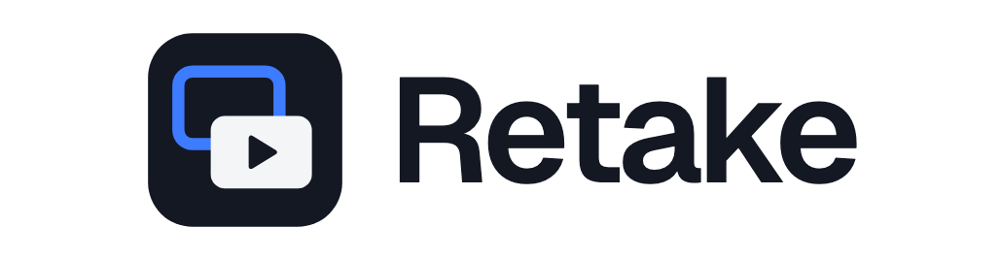
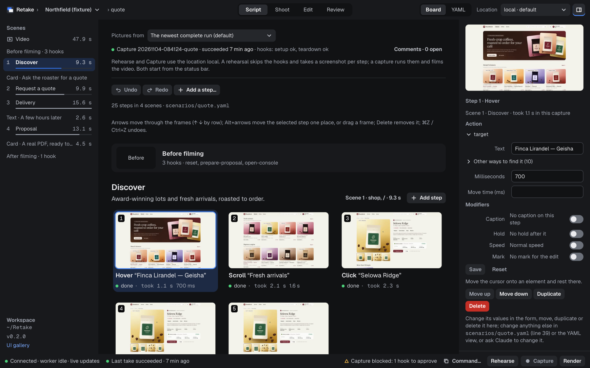
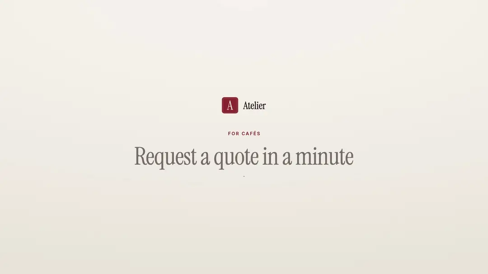
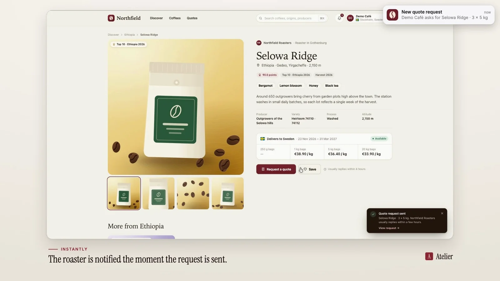
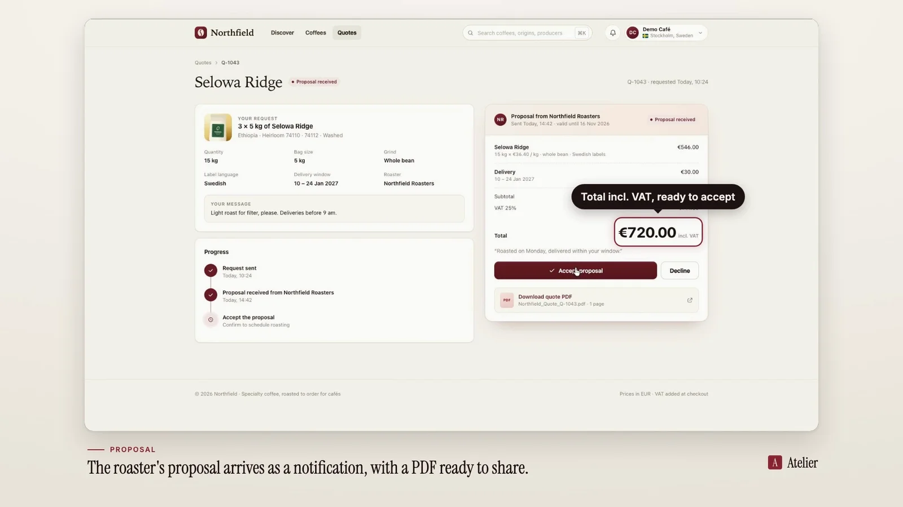
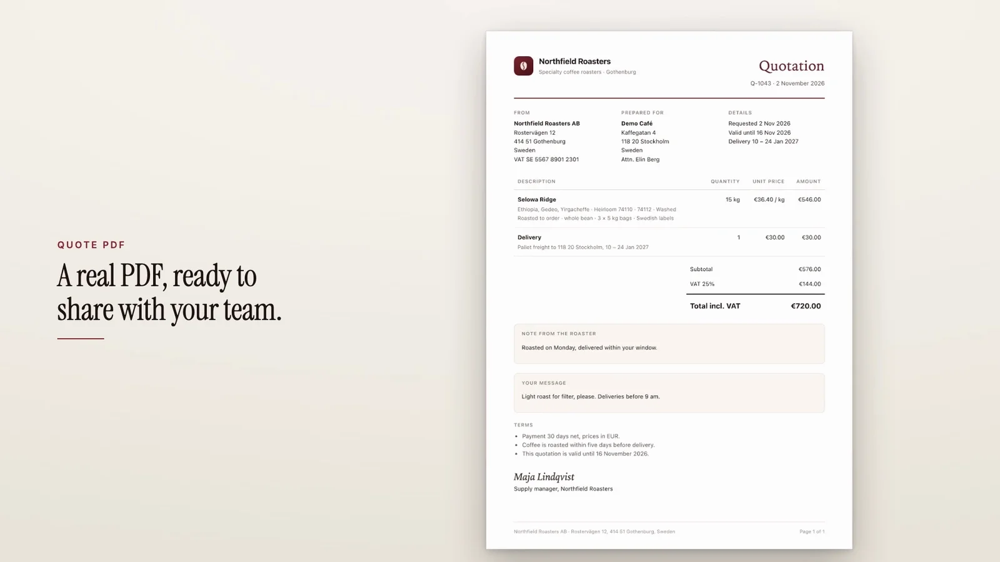
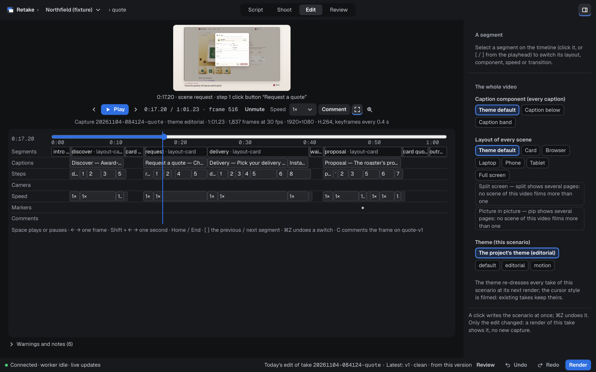
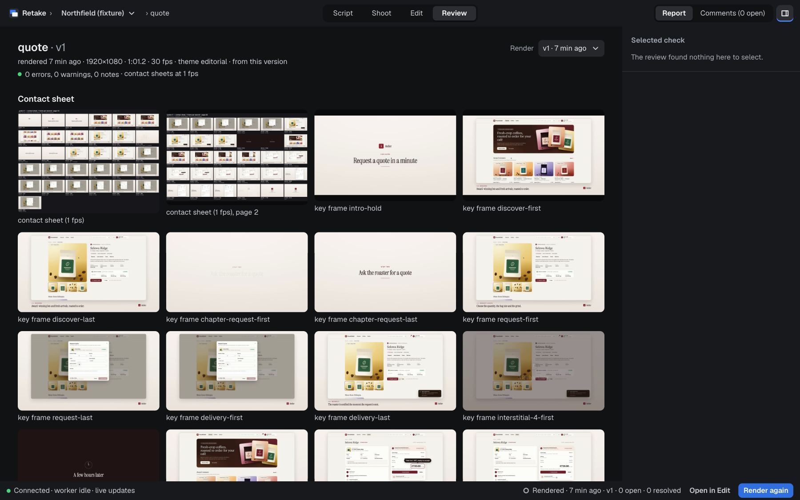
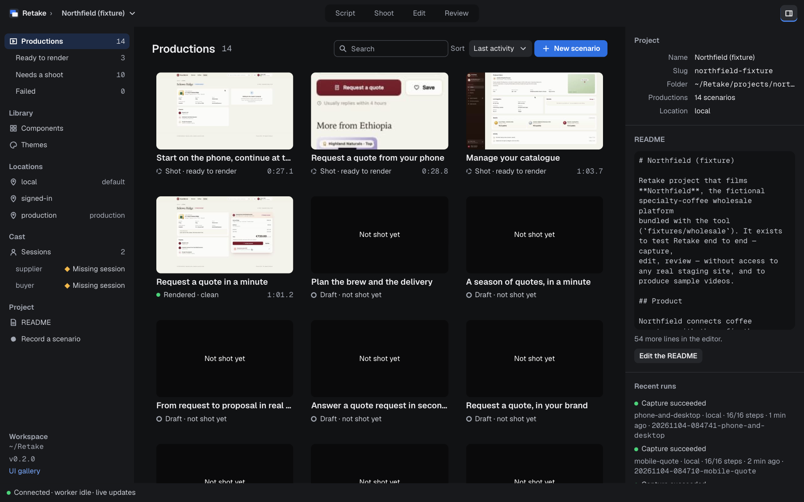
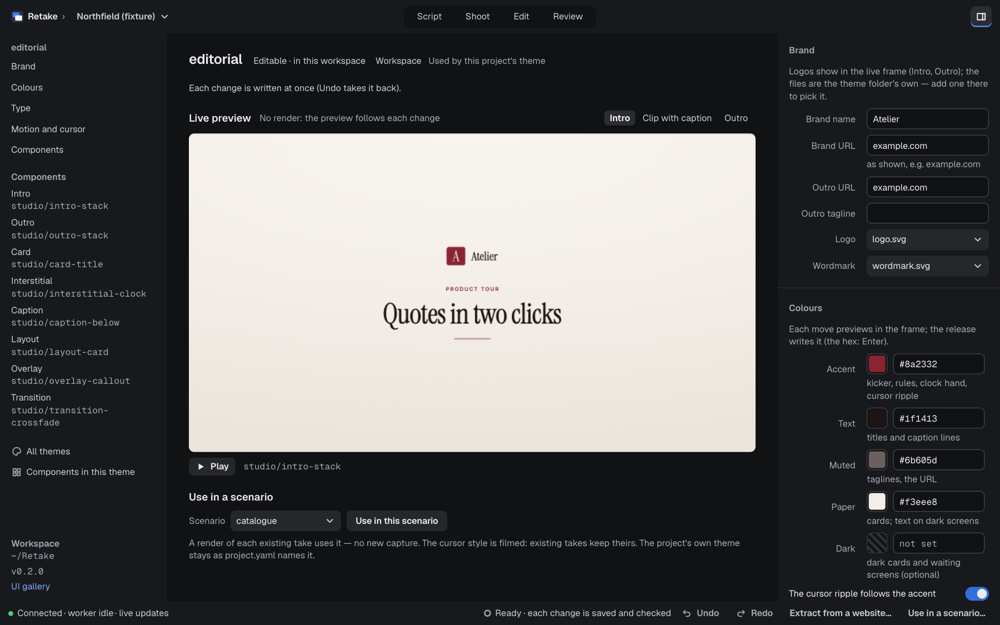

<p align="center">
  <picture>
    <source media="(prefers-color-scheme: dark)" srcset=".github/assets/retake-lockup-dark.png">
    
  </picture>
</p>

<p align="center">
  Write a scenario, get a finished product video: Retake drives your real web app with a cursor of its own,<br>
  films it, edits it with your brand's look and checks the result, from a YAML file or with Claude.
</p>

<p align="center">
  <a href="#installation"><b>Download</b></a> ·
  <a href="#features"><b>Features</b></a> ·
  <a href="#quick-start"><b>Quick start</b></a> ·
  <a href="#the-scenario-language"><b>Scenarios</b></a> ·
  <a href="docs/guide/README.md"><b>Guide</b></a> ·
  <a href="CHANGELOG.md"><b>Changelog</b></a>
</p>

<p align="center">
  
  
  
  
  <a href="LICENSE"></a>
</p>

<p align="center">
  <picture>
    <source media="(prefers-color-scheme: light)" srcset=".github/assets/studio-script-light.png">
    
  </picture>
</p>

## Contents

- [Why Retake](#why-retake)
- [A finished video](#a-finished-video)
- [Installation](#installation)
- [Quick start](#quick-start)
- [Features](#features)
- [The scenario language](#the-scenario-language)
- [How it works](#how-it-works)
- [Documentation](#documentation)
- [Development](#development)
- [Contributing](#contributing)
- [Security](#security)
- [Licence](#licence)

## Why Retake

- **A script, not a screen recording.** A video is a YAML file you can read, review and keep in git. Change the
  product, run it again: the video follows, take after take.
- **Your real product.** Retake drives the app in a headless browser at any resolution, with the cursor drawn
  inside the page, so every click and every reaction of the screen land on the same frame. Your screen stays yours
  while it films.
- **Edited for you.** Intro, captions, cards, zooms, transitions and outro come from a theme made from your brand;
  switch the theme or a layout and render again, without filming again.
- **Checked before you watch.** Every render gets contact sheets, key frames and automatic checks, and people
  comment on frames.
- **Claude can do all of it.** The built-in MCP server and Claude skills let Claude write the scenario, film it,
  render it and fix what a comment asks, with you approving what touches your data.
- **Local.** Your projects, themes and signed-in sessions stay on your computer, in a folder of your own.

## A finished video

The fixture product's `quote` scenario, captured, edited and reviewed by Retake with no hand editing (22 s of the
61 s video):

<p align="center">
  
</p>

<table>
  <tr>
    <td></td>
    <td></td>
    <td></td>
  </tr>
  <tr>
    <td align="center">A notification the product sent, captured and overlaid</td>
    <td align="center">A callout on what matters</td>
    <td align="center">The PDF the product made, as a card</td>
  </tr>
</table>

## Installation

### The macOS app

Download `Retake_<version>_aarch64.dmg` from the [Releases](../../releases/latest) page (macOS 15 or later, Apple
silicon), open it and drag **Retake** onto **Applications**. Or with Homebrew, from the first release (v0.2.0) on:

```bash
brew install --cask bramvanosta/tap/retake        # stable releases
brew install --cask bramvanosta/tap/retake@beta   # release candidates and stable releases
```

The app carries everything it needs: its own Node.js, engine, Chromium, ffmpeg, starter themes and Claude plugin.

- **Gatekeeper.** A release notarised by Apple opens without a warning. A build that is not notarised (its release
  page says so) is refused the first time: try to open it once, then System Settings › Privacy & Security › **Open
  Anyway**.
- **Open it from Applications**, not from the disk image or Downloads: macOS would run a temporary, read-only copy.
- **The first run** asks for a workspace: **Create ~/Retake** (the default) or **Choose a Folder…**.
- **The `retake` command.** The Set-up sheet (Help › Set Up Retake…) links `~/.local/bin/retake` to the command
  inside the app, and registers Retake with Claude Code and Claude Desktop, each on a click. The command is also at
  `/Applications/Retake.app/Contents/Resources/bin/retake`.
- **Updates.** The app updates itself, installed from the DMG or with Homebrew: it checks for a new version at most
  once a day, shows its notes and installs only when you click.

More in [The desktop app](docs/guide/desktop-app.md#install-the-app-macos).

### From source

For development, or on Linux. You need Node.js 22+, pnpm 10, ffmpeg and ffprobe 5.1+ and a Chromium for
Playwright ([Install and requirements](docs/guide/install.md#requirements) has the details).

```bash
pnpm install
pnpm build
pnpm --filter @retake/runner-web exec playwright-core install chromium   # once, unless you point Retake at a Chrome
pnpm retake doctor                                                        # is this machine ready?
```

`pnpm retake …` runs `node packages/cli/dist/bin.js …`. To call `retake` from anywhere, alias it:
`alias retake="node /path/to/retake/packages/cli/dist/bin.js"`.

## Quick start

### Your product

In your workspace (the app made `~/Retake`; elsewhere `retake init <folder>` makes one):

```bash
retake new acme-demo --name "Acme demo" --env "local=app:http://localhost:3000"   # a project and its pages
retake inspect acme-demo app                    # the page's elements, each with a target that works
```

Write `projects/acme-demo/scenarios/first.yaml` (see [The scenario language](#the-scenario-language)), then:

```bash
retake validate acme-demo first                 # line and column for every problem
retake run acme-demo first --dry                # a screenshot per step, no recording
retake run acme-demo first                      # the capture: capture.mp4 + timeline.json
retake render acme-demo first --review          # the video in renders/, its review in review/
retake export acme-demo latest --scenario first --formats all   # 1080p, 4K, WebM, vertical, square, a GIF preview
```

Or open the Studio (`retake ui`, or the app) and do the same with buttons; or ask Claude.

### The bundled fixture product

The repository ships a fictional product to film: **Northfield**, a B2B specialty-coffee wholesale platform with a
supplier console and a buyer shop, built with real Radix UI and Base UI components (`fixtures/wholesale`), and a
project that films it (`projects/northfield-fixture`).

```sh
pnpm install
pnpm build
pnpm retake doctor                                               # is this machine ready?

# terminal 1 — the fixture product (supplier console on :4401, buyer shop on :4402)
pnpm fixture

# terminal 2
pnpm retake list
pnpm retake validate northfield-fixture catalogue
pnpm retake run northfield-fixture catalogue --dry --hooks run   # screenshots of every step, no recording
pnpm retake run northfield-fixture catalogue                     # capture.mp4 + timeline.json
pnpm retake run northfield-fixture quote
pnpm retake run northfield-fixture signup                        # sign-up email, phone cards, tap-open
pnpm retake render northfield-fixture quote --review             # the video above, and its review
```

The repository root's `retake.yaml` makes the repository a workspace holding the fixture project and the starter
themes.

## Features

### Capture

- **A real browser, headless.** Chromium at any virtual resolution (4K included), one process per take, with
  deterministic pacing: eased cursor moves, hover before click, typing at a natural speed, animated scrolls.
- **Targets that hold.** Text, role, label, test id, CSS and more, scoped to a dialog or a region;
  `retake inspect` lists a page's elements with targets that were checked.
- **Data ready before the take.** Setup and teardown hooks (HTTP, SQL, shell, in-page JavaScript) with their
  rollback, and [sandboxes](docs/guide/sandbox.md): a disposable copy of your product, seeded and reset before
  every take (Postgres snapshots, Docker Compose).
- **What happens outside the page.** The email that lands, the PDF the product makes, the notification it shows:
  captured with the run and shown in the video.
- **Several pages at once.** Two pages on one clock, the shop and the console or a desktop and a phone, shown
  side by side or one over the other.
- **Signed in, safely.** Personas whose sessions stay on your computer, display URLs instead of `localhost`, and
  read-only production environments.
- **Or perform it.** `retake record` turns what you do in a browser into a scenario.

### Edit

- **Themes from your brand.** Colours, fonts, logo and motion in a theme; make one from your brand files or from
  your website, and change it in the Studio's live preview.
- **Components.** Intros, outros, captions, layouts (browser, laptop, phone, tablet, card), cards, callouts, lower
  thirds, transitions, tutorial overlays (key caps, spotlight, loupe, step badges): a built-in library, and your own
  in React.
- **Variants.** Vertical and square versions reframed on the cursor, 4K, a music bed, your own video, image and
  Lottie segments and overlays.
- **For editing tools too.** `retake export-capture` writes a raw package: clips per scene, the cursor baked, absent
  or on a transparent layer, and FCPXML, EDL and OTIO markers.

<p align="center">
  
</p>

### Review

- **Contact sheets and key frames** for every render, and **checks**: frozen or blank frames, a caption cut short,
  a cursor that misses its target, an error the app showed, a page without a display URL.
- **Frame comments.** Anyone comments on a frame; Claude reads the thread, changes the scenario, films again and
  replies.

<p align="center">
  
</p>

### The Studio

`retake ui` (or the app) opens the Studio on your computer: your productions, a scenario as blocks with the frames of
its latest capture, rehearsal and capture with live progress, the edit timeline, the review, frame comments, the
component library, the theme editor and recording.

<table>
  <tr>
    <td></td>
    <td></td>
  </tr>
</table>

### Claude

- **An MCP server** (`retake mcp`, over stdio or HTTP) with tools for projects, scenarios, page inspections,
  captures, renders, reviews, themes, components and comments. Long work runs as jobs in a background worker.
- **Claude skills** for scenarios, themes and components, bundled with the server in a Claude Code plugin.
- **You stay in charge.** Hooks and seed commands wait for your approval; text read from a page or a comment is data,
  never an instruction.

## The scenario language

A scenario is `scenarios/<name>.yaml` in a project. Every step has one action (`open`, `click`, `type`, `select`,
`scroll`, `hover`, `press`, `drop_file`, `wait_for`, `download`, `wait_for_email`…) and optional modifiers (`caption`,
`hold`, `mark`, `camera`, `overlay`…):

```yaml
version: 1
video: quote-request
title: {kicker: For buyers, text: Request a quote in a minute}
outro: {tagline: "From request to proposal, in one place."}
scenes:
  - id: discover
    caption: {kicker: Discover, text: "Fresh arrivals, roasted to order."}
    page: shop                  # a page of the project's environment
    open: /
    steps:
      - scroll: {to: {text: Fresh arrivals}, offset: -100, duration: 1.6}
      - click: {role: button, name: Request a quote}
      - wait_for: {target: {role: dialog}}
        mark: dialog-open
  - id: request                 # continues where the previous scene left off
    caption: {kicker: Request a quote, text: "Choose the quantity, the bag size and the grind."}
    steps:
      - click: {aria: Increase, in: dialog}
      - select: {field: Bag size, option: 5 kg}
      - type: {into: {label: Message}, text: "Light roast for filter, please.", cps: 18}
      - click: {text: Send request, in: dialog}
        irreversible: true      # never executed by a dry run
      - wait_for: {text: Quote request sent}
        hold: 2
```

`retake validate` checks a scenario with a line and a column for every problem, and `retake schema scenario` prints
its JSON Schema for your editor. The whole language — actions, targets, templating, hooks, secrets, what happens when
a take goes wrong — is in [Scenarios](docs/guide/scenarios.md).

## How it works

Retake turns a precise, written scenario into a professional product video. It drives a real web app in a
headless browser at any virtual resolution, draws the cursor **inside the page** (so clicks and screen reactions are
in sync by construction), records the screen through the Chrome DevTools screencast, and writes a timeline of every
step. It then edits that capture automatically into a finished video (themes, components, captions,
intro/outro), produces review artefacts, and exposes everything to an AI agent through an MCP server.

1. You describe a video in YAML: scenes, steps (`click`, `type`, `select`, `scroll`, `drop_file`…), captions and
   edit hints. `retake validate` checks it with line/column messages before anything runs.
2. `retake run` launches Chromium headless (new headless mode) with the project's viewport, injects a small in-page
   kit (cursor overlay + element resolver) into every document, and executes the whole scenario in one process with
   deterministic pacing: eased cursor moves at ~60 Hz with the real mouse, hover before click, popup-aware click
   strategies, typing at a natural speed, animated scrolls.
3. Setup hooks prepare the data first (HTTP, SQL, shell, in-page JS) and are journaled with their rollback;
   teardown hooks always run, then pending rollbacks are replayed.
4. The run produces `capture.mp4` (constant frame rate, H.264) and `timeline.json` (every scene and step with its
   start/end/click times in capture time, target boxes, markers, page/URL segments, the cursor track, idle intervals
   and the page loads the capture held) — the inputs of the editor. The capture never shows a page that has not
   painted yet: during a full page load it keeps the previous picture until the new page has painted content of its
   own.
5. `retake render` plans the edit from the timeline (captions, layouts, zooms, cuts of the waits, transitions) and
   draws it with Remotion in the project's theme; `--review` adds the contact sheets,
   key frames, checks and report.

Because the browser is headless and offscreen, a capture does not take over your screen: keep working while it runs.

The tool is generic: it is not tied to any product or brand. Your projects, themes, logos, scripts and hooks live in
**your own workspace folder**, never in this repository; signed-in sessions stay on your computer, outside any project
(`~/.retake`).

## Documentation

The [guide](docs/guide/README.md) holds the full reference:

| | |
|---|---|
| [Install and requirements](docs/guide/install.md) | what a machine needs, and where Retake finds its tools |
| [Workspaces and projects](docs/guide/workspace.md) | your workspace, a project's files, what a run writes |
| [Command-line reference](docs/guide/cli.md) | every `retake` command and flag |
| [Scenarios](docs/guide/scenarios.md) | the scenario language, several pages, mails and documents, recording |
| [Themes, components and media](docs/guide/themes-and-components.md) | themes, the component library and kit, your own media |
| [Editing, rendering and export](docs/guide/editing.md) | the edit plan, overlays and cards, rendering, variants, raw export |
| [Review and frame comments](docs/guide/review.md) | contact sheets, checks, reports, comments |
| [Sign-ins and environments](docs/guide/environments.md) | personas and sessions, display URLs, production, read-only |
| [Sandboxes](docs/guide/sandbox.md) | a disposable copy of your product for every take |
| [Claude and MCP](docs/guide/mcp.md) | the MCP server, the skills and the plugin |
| [The Studio](docs/guide/studio.md) | the web app, screen by screen |
| [The desktop app](docs/guide/desktop-app.md) | Retake.app, its updates, the desktop shell |
| [Security model](docs/guide/security.md) | what Retake protects, and how |
| [Upgrading from before L5.13](docs/guide/upgrading.md) | moving an installation from the tool's earlier name |

## Development

```bash
pnpm install
pnpm build          # TypeScript project references
pnpm test           # the full vitest suite (build first; the slow, Docker and Postgres suites are opt-in)
```

[Development](docs/guide/development.md) covers the repository's layout and every test suite,
[RELEASING.md](docs/RELEASING.md) how a release is built, and `CLAUDE.md` and `docs/HANDOFF.md` how the project is
worked on with Claude Code.

| | |
|---|---|
| **Engine** | TypeScript, Node.js 22, Playwright (Chromium), ffmpeg |
| **Editor** | Remotion, React |
| **Studio** | React, esbuild, a local HTTP server on 127.0.0.1 |
| **Desktop app** | Tauri v2, Rust |
| **Claude** | the MCP TypeScript SDK, Claude skills and a Claude Code plugin |

## Contributing

Issues and pull requests are welcome: see [CONTRIBUTING.md](CONTRIBUTING.md).

## Security

Please report a vulnerability privately: see [SECURITY.md](SECURITY.md).

## Licence

Retake is released under the [MIT licence](LICENSE). It renders its videos with Remotion, which is not open source:
its own licence (the `LICENSE.md` of its npm package) applies to everyone who renders with Retake, free for individuals
and for companies of up to three people. The macOS app also carries GPL builds of FFmpeg, each with its notice and source offer in
[`apps/desktop/licenses/`](apps/desktop/licenses/).
