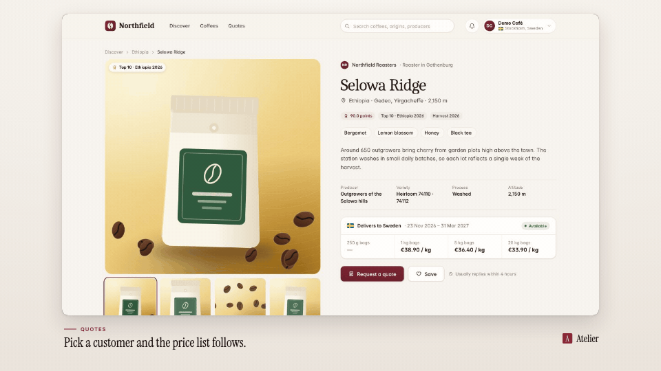

<!-- studio:component-preview:begin (generated by `retake components preview`; edit component.yaml instead) -->
# Caption below

`studio/caption-below` · caption · v1.0.0

Accent rule and uppercase kicker over one display line in the layout's caption area, left-aligned with the card; the old line fades out and the new one rises in at each cue change.

*Preview: the editorial theme, 0.6 s into the component, over the desktop sample screen; the manifest's preview samples.*

## Slots

| slot | type | default from | max chars | description |
|---|---|---|---|---|
| `text` | text | scene.caption.text | 90 | Caption line (when no cues are given). |
| `kicker` | text | scene.caption.kicker | 40 | Small line above the caption. |

## Params

| param | type | default | description |
|---|---|---|---|
| `position` | `below` \| `above` | below | below: the layout's caption area; above: a band at the top of the frame. |
| `align` | `left` \| `center` | left | Alignment in the caption area. |
| `max_lines` | integer (1–3) | 1 | Lines of the caption line (it shrinks to fit first, down to 62 % of the theme size; vertical: at least 2). |
| `rule` | boolean | true | Short accent rule before the kicker. |

- variants: landscape, vertical
- theme tokens: `colors.accent`, `colors.text`, `colors.paper`, `fonts.display`, `fonts.body`, `captions.kicker`, `captions.line`, `style_bias`

Regenerate the preview and this block with `retake components preview studio/caption-below`.
<!-- studio:component-preview:end -->
