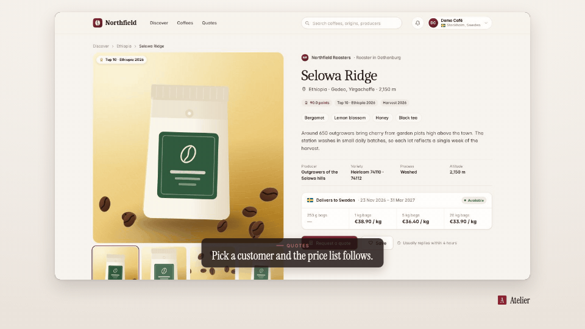

<!-- studio:component-preview:begin (generated by `retake components preview`; edit component.yaml instead) -->
# Caption band

`studio/caption-overlay` · caption · v1.0.0

The active cue on a translucent band over the bottom of the capture — the theme-coloured kicker with an accent rule over the caption line, light on the theme's night tone; for raw, browser and motion-style edits.

*Preview: the editorial theme, 0.8 s into the component, over the desktop sample screen; the manifest's preview samples.*

## Slots

| slot | type | default from | max chars | description |
|---|---|---|---|---|
| `text` | text | scene.caption.text | 90 | Caption line (when no cues are given). |
| `kicker` | text | scene.caption.kicker | 40 | Small uppercase line above the caption. |

## Params

| param | type | default | description |
|---|---|---|---|
| `position` | `over` \| `area` | over | over: a band over the bottom of the capture (the caption area when the capture is narrower than 900 px); area: in the layout's caption area. |
| `align` | `center` \| `left` | center | Alignment of the text in the band. |
| `opacity` | number (0.3–1) | 0.84 | Opacity of the band. |
| `max_width` | number (400–1800) | 1400 | Widest band in design px. |
| `max_lines` | integer (1–3) | 2 | Lines of the caption line (it shrinks to fit first, down to 62 % of the theme size). |

- variants: landscape, vertical
- theme tokens: `colors.accent`, `colors.text`, `colors.paper`, `colors.dark`, `fonts.display`, `fonts.body`, `captions.kicker`, `captions.line`, `style_bias`

Regenerate the preview and this block with `retake components preview studio/caption-overlay`.
<!-- studio:component-preview:end -->
