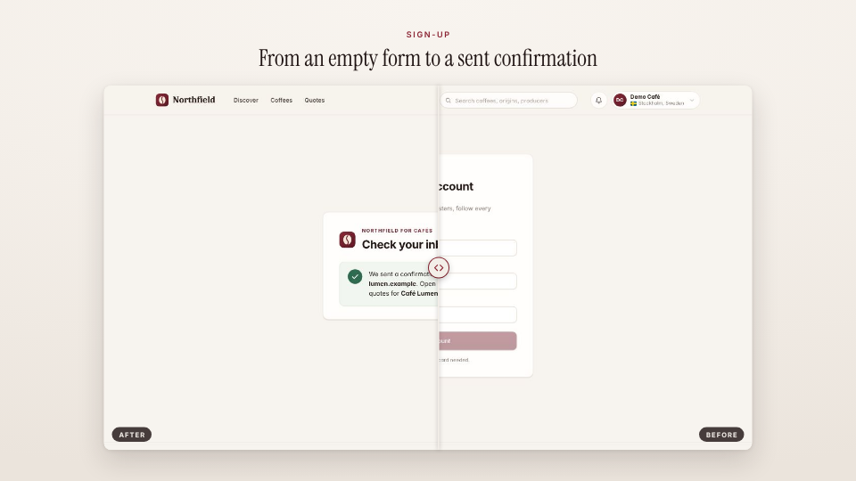

<!-- studio:component-preview:begin (generated by `studio components preview`; edit component.yaml instead) -->
# Before / after

`studio/card-before-after` · card · v1.0.0

Two frames of the capture (by mark, scene start/end or time) or two images in one card, the after wiping over the before behind a divider, with labels and a title.

*Preview: the editorial theme, 1.7 s into the component; the manifest's preview samples.*

## Slots

| slot | type | default from | max chars | description |
|---|---|---|---|---|
| `before` (required) | frame |  |  | The first picture: a mark, start:<scene>, end:<scene>, a capture time (12.5s) or an image file. |
| `after` (required) | frame |  |  | The second picture (same forms). |
| `title` | text |  | 60 | The card title. |
| `kicker` | text |  | 40 | Small uppercase line above the title. |
| `before_label` | text |  | 20 | Label of the first picture (default "Before"). |
| `after_label` | text |  | 20 | Label of the second picture (default "After"). |

## Params

| param | type | default | description |
|---|---|---|---|
| `wipe_at` | number (0–10) | 1.1 | Seconds before the wipe starts. |
| `wipe` | number (0.2–6) | 1.6 | Seconds the wipe takes. |
| `direction` | `left-to-right` \| `right-to-left` \| `top-to-bottom` | left-to-right | Where the after comes from. |
| `end_at` | number (0.3–1) | 1 | Where the divider stops (1: the after fills the card; 0.5: half and half). |
| `tone` | `paper` \| `dark` | paper | paper: the theme background; dark: the theme's night tone. |

- duration 4.5 s (2–15 s)
- variants: landscape, vertical, square
- theme tokens: `colors.accent`, `colors.text`, `colors.muted`, `colors.paper`, `colors.dark`, `background`, `fonts.display`, `fonts.body`, `style_bias`

Regenerate the preview and this block with `studio components preview studio/card-before-after`.
<!-- studio:component-preview:end -->
