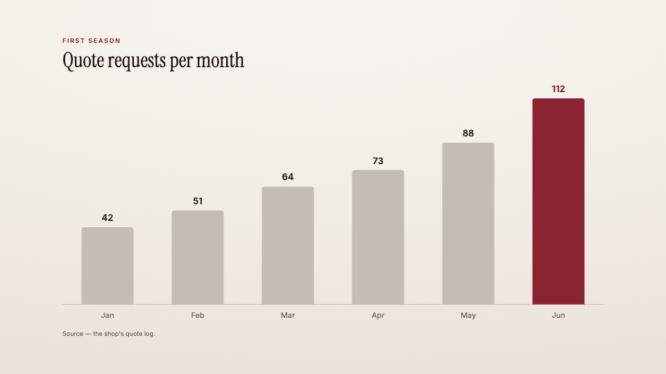

<!-- studio:component-preview:begin (generated by `retake components preview`; edit component.yaml instead) -->
# Chart

`studio/card-chart` · card · v1.0.0

Full-screen animated bar or line chart from inline data or a CSV file of the project, the highlighted value in the accent, with kicker, title and a source line.

*Preview: the editorial theme, 3 s into the component; the manifest's preview samples.*

## Slots

| slot | type | default from | max chars | description |
|---|---|---|---|---|
| `title` | text |  | 60 | The card title. |
| `kicker` | text |  | 40 | Small uppercase line above the title. |
| `data` | data |  |  | A CSV / TSV file of the project (header row, then one row per point). |
| `note` | text |  | 100 | A source or footnote line under the chart. |

## Params

| param | type | default | description |
|---|---|---|---|
| `type` | `bar` \| `line` | bar | Bars or a line. |
| `data` | array | [] | Inline points (used when no `data` file is given). |
| `x` | string |  | Column of the categories in the file (default — the first). |
| `y` | string |  | Column of the values in the file (default — the first numeric column). |
| `highlight` | string |  | Category drawn in the accent (default — the last; "none": none). |
| `prefix` | string |  | Before each value ("€"). |
| `suffix` | string |  | After each value (" %", "k"). |
| `decimals` | number (-1–4) | -1 | Decimals of the values (-1 — as in the data, at most 2). |
| `max_points` | number (2–24) | 12 | The last N points are shown. |
| `tone` | `paper` \| `dark` | paper | paper: the theme background; dark: the theme's night tone with light type. |

- duration 5 s (2–15 s)
- variants: landscape, vertical, square
- theme tokens: `colors.accent`, `colors.text`, `colors.muted`, `colors.paper`, `colors.dark`, `background`, `fonts.display`, `fonts.body`, `style_bias`

Regenerate the preview and this block with `retake components preview studio/card-chart`.
<!-- studio:component-preview:end -->
