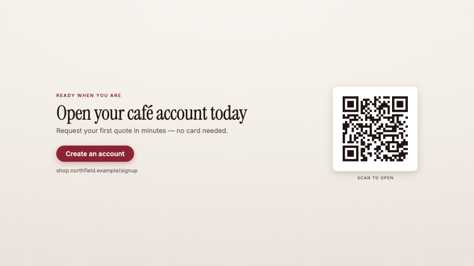

<!-- studio:component-preview:begin (generated by `retake components preview`; edit component.yaml instead) -->
# Call to action

`studio/card-cta` · card · v1.0.0

Final call to action — kicker, title, text, an accent button with the URL under it and a locally generated QR code — on the theme background or night tone.

*Preview: the editorial theme, 2.4 s into the component; the manifest's preview samples.*

## Slots

| slot | type | default from | max chars | description |
|---|---|---|---|---|
| `title` (required) | text |  | 60 | The call to action. |
| `kicker` | text |  | 40 | Small uppercase line above the title. |
| `text` | text |  | 140 | Optional supporting line. |
| `button` | text |  | 32 | Button text (default "Get started"). |
| `url` | url | theme.brand.url | 60 | The address shown under the button (default — the theme's brand url) — shown only (never loaded). |
| `qr` | url |  | 300 | What the QR code opens (default — the url; "https://" is added when it has no scheme) — encoded locally (never loaded). |
| `qr_label` | text |  | 40 | Line under the QR code (default "Scan to open"). |

## Params

| param | type | default | description |
|---|---|---|---|
| `tone` | `paper` \| `dark` | paper | paper: the theme background; dark: the theme's night tone with light type. |
| `show_qr` | boolean | true | Show the QR code. |
| `qr_level` | `L` \| `M` \| `Q` \| `H` | M | QR error correction (H survives the most damage, makes a denser code). |

- duration 4.5 s (2–15 s)
- variants: landscape, vertical, square
- theme tokens: `colors.accent`, `colors.text`, `colors.muted`, `colors.paper`, `colors.dark`, `background`, `fonts.display`, `fonts.body`, `brand.url`, `style_bias`

Regenerate the preview and this block with `retake components preview studio/card-cta`.
<!-- studio:component-preview:end -->
