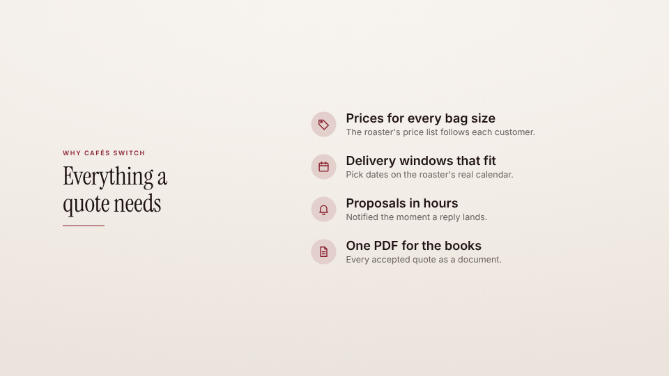

<!-- studio:component-preview:begin (generated by `studio components preview`; edit component.yaml instead) -->
# Feature list

`studio/card-features` · card · v1.0.0

Full-screen list of 3–5 features appearing one by one — icon (built-in set) or number, title and a line of text — beside a kicker, display title and accent rule.

*Preview: the editorial theme, 3.4 s into the component; the manifest's preview samples.*

## Slots

| slot | type | default from | max chars | description |
|---|---|---|---|---|
| `title` (required) | text |  | 60 | The card title. |
| `kicker` | text |  | 40 | Small uppercase line above the title. |

## Params

| param | type | default | description |
|---|---|---|---|
| `items` | array | [] | The features (3 to 5 read best), in order. |
| `stagger` | number (0.1–2) | 0.45 | Seconds between two items. |
| `tone` | `paper` \| `dark` | paper | paper: the theme background; dark: the theme's night tone with light type. |

- duration 5 s (2–15 s)
- variants: landscape, vertical, square
- theme tokens: `colors.accent`, `colors.text`, `colors.muted`, `colors.paper`, `colors.dark`, `background`, `fonts.display`, `fonts.body`, `style_bias`

Regenerate the preview and this block with `studio components preview studio/card-features`.
<!-- studio:component-preview:end -->
