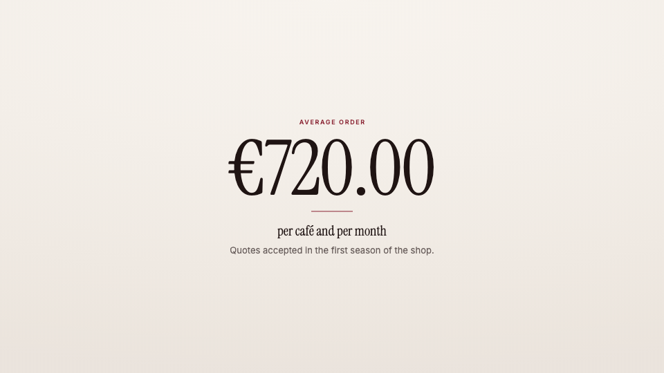

<!-- studio:component-preview:begin (generated by `retake components preview`; edit component.yaml instead) -->
# Key figure

`studio/card-figure` · card · v1.0.0

Full-screen key figure — kicker, a big animated counter (value from the scenario or captured from the page), accent rule, label and text — on the theme background or night tone.

*Preview: the editorial theme, 2.6 s into the component; the manifest's preview samples.*

## Slots

| slot | type | default from | max chars | description |
|---|---|---|---|---|
| `value` | text |  | 24 | The figure as it should read at the end ("€720.00", "921", "+38 %"). |
| `capture` | capture |  |  | A text the run read with capture_text (`as`): its value is the figure. |
| `kicker` | text |  | 40 | Small uppercase line above the figure. |
| `label` | text |  | 60 | What the figure counts, under it. |
| `text` | text |  | 140 | Optional supporting line. |

## Params

| param | type | default | description |
|---|---|---|---|
| `from` | number | 0 | Where the counter starts. |
| `count` | number (0–6) | 1.6 | Seconds the counter runs (0 = no counting). |
| `tone` | `paper` \| `dark` | paper | paper: the theme background; dark: the theme's night tone with light type. |
| `align` | `center` \| `left` | center | Alignment of the column. |

- duration 3.5 s (1.5–12 s)
- variants: landscape, vertical, square
- theme tokens: `colors.accent`, `colors.text`, `colors.muted`, `colors.paper`, `colors.dark`, `background`, `fonts.display`, `fonts.body`, `style_bias`

Regenerate the preview and this block with `retake components preview studio/card-figure`.
<!-- studio:component-preview:end -->
