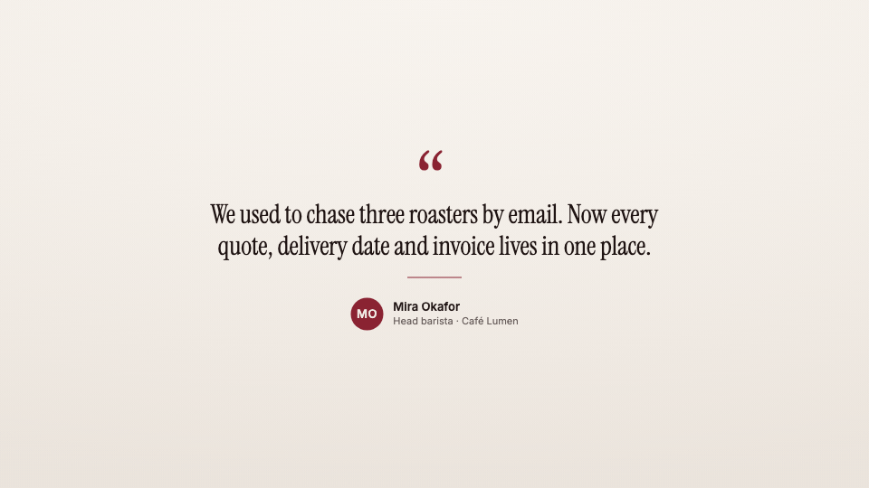

<!-- studio:component-preview:begin (generated by `retake components preview`; edit component.yaml instead) -->
# Testimonial

`studio/card-testimonial` · card · v1.0.0

Full-screen quote — large quotation mark, the quote in the display font, accent rule, avatar (or initials), name, role and company logo — staggered in.

*Preview: the editorial theme, 3.2 s into the component; the manifest's preview samples.*

## Slots

| slot | type | default from | max chars | description |
|---|---|---|---|---|
| `quote` (required) | text |  | 220 | The quote (without quotation marks). |
| `name` (required) | text |  | 40 | Who said it. |
| `role` | text |  | 60 | Their role. |
| `company` | text |  | 40 | Their company (after the role; or alone). |
| `logo` | image |  |  | The company logo (an image file of the project or a URL). |
| `avatar` | image |  |  | A photo (an image file of the project or a URL); default — the initials. |

## Params

| param | type | default | description |
|---|---|---|---|
| `tone` | `paper` \| `dark` | paper | paper: the theme background; dark: the theme's night tone with light type. |
| `align` | `center` \| `left` | center | Alignment of the column. |
| `marks` | boolean | true | The large quotation mark. |

- duration 5 s (2–15 s)
- variants: landscape, vertical, square
- theme tokens: `colors.accent`, `colors.text`, `colors.muted`, `colors.paper`, `colors.dark`, `background`, `fonts.display`, `fonts.body`, `style_bias`

Regenerate the preview and this block with `retake components preview studio/card-testimonial`.
<!-- studio:component-preview:end -->
