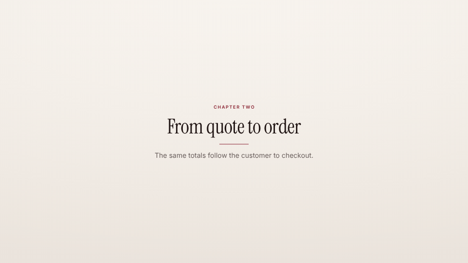

<!-- studio:component-preview:begin (generated by `studio components preview`; edit component.yaml instead) -->
# Title card

`studio/card-title` · card · v1.0.0

Full-screen chapter card — uppercase kicker, display title, an accent rule drawn from the centre and an optional line of text — staggered in on the theme background or the theme's night tone.

*Preview: the editorial theme, 1.5 s into the component; the manifest's preview samples.*

## Slots

| slot | type | default from | max chars | description |
|---|---|---|---|---|
| `title` (required) | text |  | 60 | The card title. |
| `kicker` | text |  | 40 | Small uppercase line above the title. |
| `text` | text |  | 140 | Optional supporting line under the title. |

## Params

| param | type | default | description |
|---|---|---|---|
| `align` | `center` \| `left` | center | Alignment of the column. |
| `rule` | boolean | true | Draw the accent rule under the title. |
| `tone` | `paper` \| `dark` | paper | paper: the theme background; dark: the theme's night tone with light type. |

- duration 2.5 s (1–10 s)
- variants: landscape, vertical
- theme tokens: `colors.accent`, `colors.text`, `colors.muted`, `colors.paper`, `colors.dark`, `background`, `fonts.display`, `fonts.body`, `style_bias`

Regenerate the preview and this block with `studio components preview studio/card-title`.
<!-- studio:component-preview:end -->
