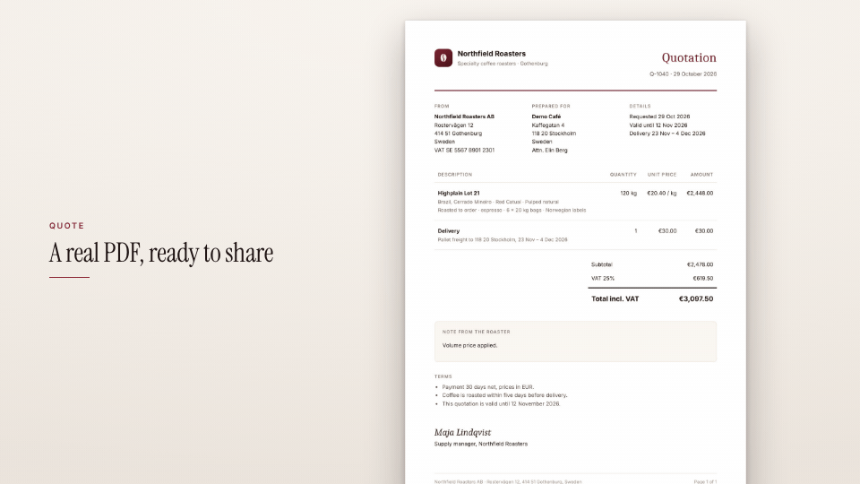

<!-- studio:component-preview:begin (generated by `studio components preview`; edit component.yaml instead) -->
# Document (PDF)

`studio/document-pdf` · card · v1.0.0

A4 page(s) of a captured or project PDF on the theme background with a paper shadow — a slow push-in, a slow scroll through the pages, or a static page / spread — with an optional kicker and title beside it.

*Preview: the editorial theme, 3.5 s into the component; the manifest's preview samples.*

## Slots

| slot | type | default from | max chars | description |
|---|---|---|---|---|
| `document` | document |  |  | A captured document (a download `as`) or a project file (assets/quote.pdf). |
| `kicker` | text |  | 40 | Small uppercase line above the title (left column). |
| `title` | text |  | 90 | Title beside the page (left column). |

## Params

| param | type | default | description |
|---|---|---|---|
| `motion` | `zoom` \| `scroll` \| `static` | zoom | zoom: slow push-in; scroll: the pages scroll by; static: still page(s). |
| `pages` | string | auto | Pages shown: "auto" (zoom / static: 1; scroll: all), "2", "1-3", "1,3" or "all". |
| `focus` | `top` \| `center` \| `bottom` | top | Where the push-in goes (zoom). |
| `zoom` | number (1–2) | 1.16 | Scale the push-in reaches. |
| `shadow` | `soft` \| `strong` | strong | Paper shadow. |

- duration 4.5 s (1.5–20 s)
- variants: landscape, vertical, square
- theme tokens: `colors.accent`, `colors.text`, `colors.muted`, `colors.paper`, `colors.dark`, `background`, `fonts.display`, `fonts.body`, `style_bias`

Regenerate the preview and this block with `studio components preview studio/document-pdf`.
<!-- studio:component-preview:end -->
