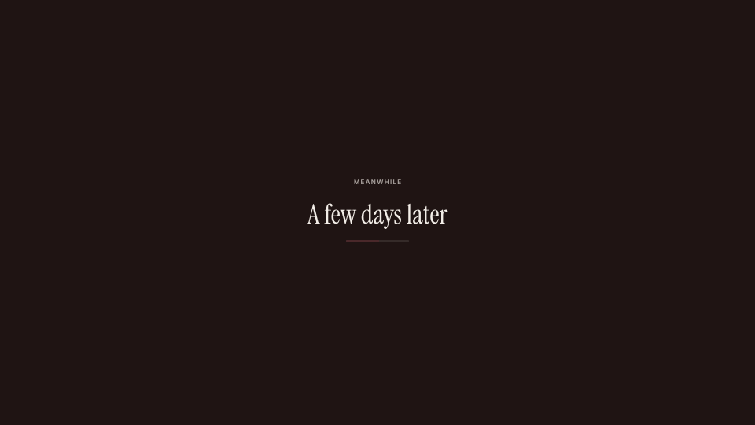

<!-- studio:component-preview:begin (generated by `studio components preview`; edit component.yaml instead) -->
# Interstitial

`studio/interstitial-plain` · interstitial · v1.0.0

Waiting screen — the last frame dims under the theme's night tone (dark) or its paper (paper), then a kicker, the text and a slowly filling accent line rise in, centred.

*Preview: the editorial theme, 1.4 s into the component, over the desktop sample screen; the manifest's preview samples.*

## Slots

| slot | type | default from | max chars | description |
|---|---|---|---|---|
| `text` (required) | text | interstitial.text | 60 | What happens meanwhile ("Two days later"). |
| `kicker` | text | interstitial.kicker | 40 | Small uppercase line above the text. |
| `screen` | screen |  |  | The last frame of the previous clip, drawn under the veil. |

## Params

| param | type | default | description |
|---|---|---|---|
| `tone` | `dark` \| `paper` | dark | dark: the theme's night tone with light type; paper: the theme's paper with its text colour. |
| `dim` | number (0–1) | 1 | Final opacity of the veil over the last frame (1 = a full card). |

- duration 2.6 s (1–8 s)
- variants: landscape, vertical
- theme tokens: `colors.accent`, `colors.text`, `colors.paper`, `colors.muted`, `colors.dark`, `background`, `fonts.display`, `fonts.body`, `style_bias`

Regenerate the preview and this block with `studio components preview studio/interstitial-plain`.
<!-- studio:component-preview:end -->
