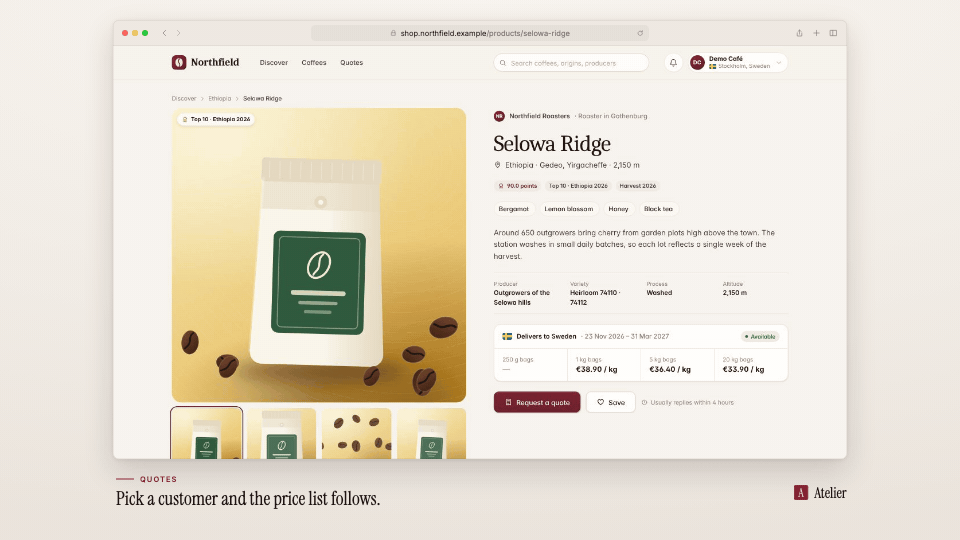

<!-- studio:component-preview:begin (generated by `studio components preview`; edit component.yaml instead) -->
# Browser window

`studio/layout-browser` · layout · v1.0.0

The capture in a macOS-style browser window (traffic lights, optional tabs, an address bar with the page's display URL) on the theme background, caption area below, brand mark right-aligned with the window.

*Preview: the editorial theme, 1 s into the component, over the desktop sample screen; the manifest's preview samples.*

## Slots

| slot | type | default from | max chars | description |
|---|---|---|---|---|
| `screen` (required) | screen |  |  | The capture (video + camera moves). |

## Params

| param | type | default | description |
|---|---|---|---|
| `width` | number (600–1920) | 1560 | Window width in design px (landscape; centred). The page area keeps the capture's aspect, at most 878 px minus the chrome tall: wider windows on 16:9 captures are capped. |
| `radius` | number (0–40) | 12 | Corner radius of the window in design px. |
| `shadow` | `none` \| `soft` \| `strong` | soft | Shadow under the window (tinted with the theme's dark tone). |
| `show_url` | boolean | true | Show the page URL in the address bar: its display URL (none for a local URL without one). |
| `tabs` | boolean | false | Add a tab strip (one tab named after the page's display host) above the toolbar. |
| `chrome` | `auto` \| `light` \| `dark` | auto | Toolbar tone: auto = dark on a dark theme background, light otherwise. |
| `controls` | `color` \| `theme` | color | Window controls: the classic red / yellow / green, or quiet dots tinted from the theme. |

- variants: landscape, vertical, square
- theme tokens: `colors.text`, `colors.paper`, `colors.dark`, `colors.accent`, `background`, `fonts.body`
- geometry: see `component.yaml` (values may follow the params and the capture aspect)

Regenerate the preview and this block with `studio components preview studio/layout-browser`.
<!-- studio:component-preview:end -->
