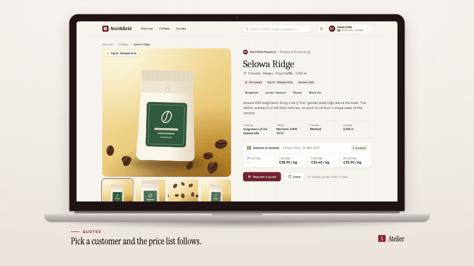

<!-- studio:component-preview:begin (generated by `retake components preview`; edit component.yaml instead) -->
# Laptop

`studio/layout-laptop` · layout · v1.0.0

The capture on the display of a MacBook-style laptop (glass bezel with a camera, hinge, aluminium base with a thumb notch) on the theme background, caption area below, brand mark right-aligned with the lid.

*Preview: the editorial theme, 1 s into the component, over the desktop sample screen; the manifest's preview samples.*

## Slots

| slot | type | default from | max chars | description |
|---|---|---|---|---|
| `screen` (required) | screen |  |  | The capture (video + camera moves). |

## Params

| param | type | default | description |
|---|---|---|---|
| `width` | number (700–1500) | 1300 | Display width in design px (landscape). The display keeps the capture's aspect; on tall captures the device shrinks so it and the caption block fit. |
| `finish` | `light` \| `dark` | light | Aluminium finish: light (silver) or dark (space grey), both tinted by the theme. |
| `shadow` | `none` \| `soft` \| `strong` | soft | Shadow under the device (tinted with the theme's dark tone). |

- variants: landscape, vertical, square
- theme tokens: `colors.text`, `colors.paper`, `colors.dark`, `background`
- geometry: see `component.yaml` (values may follow the params and the capture aspect)

Regenerate the preview and this block with `retake components preview studio/layout-laptop`.
<!-- studio:component-preview:end -->
