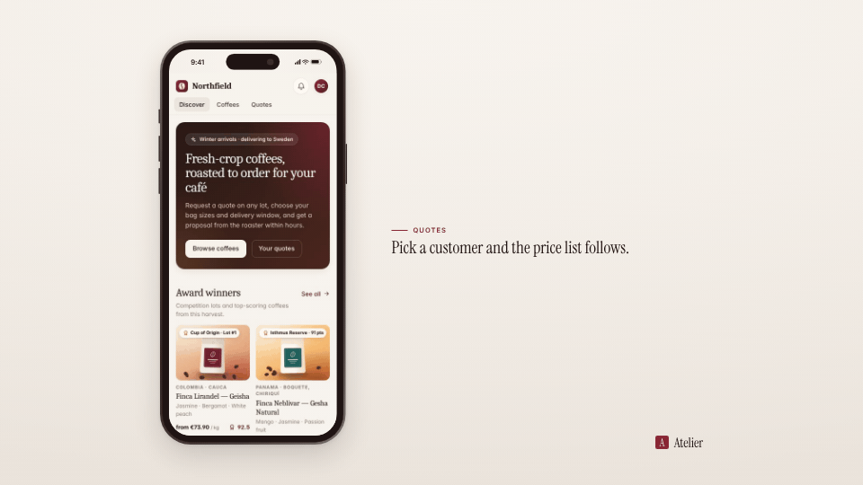

<!-- studio:component-preview:begin (generated by `studio components preview`; edit component.yaml instead) -->
# Phone

`studio/layout-phone` · layout · v1.0.0

The capture on an iPhone-style phone (metal band, glass bezel, rounded display with a status bar and the Dynamic Island, side buttons) for narrow mobile captures; the caption beside it (landscape) or below it (vertical).

*Preview: the editorial theme, 1 s into the component, over the phone sample screen; the manifest's preview samples.*

## Slots

| slot | type | default from | max chars | description |
|---|---|---|---|---|
| `screen` (required) | screen |  |  | The capture (video + camera moves). |

## Params

| param | type | default | description |
|---|---|---|---|
| `height` | number (600–900) | 860 | Display height in design px (landscape output); the width follows the capture's aspect. |
| `finish` | `dark` \| `light` | dark | Metal band: dark (graphite) or light (silver), both tinted by the theme. |
| `island` | boolean | true | Draw the Dynamic Island at the top of the display. |
| `status_bar` | boolean | true | A status bar (time, signal, battery) above the capture, around the island; without it the capture fills the display and the island floats over its top. |
| `shadow` | `none` \| `soft` \| `strong` | soft | Shadow under the phone (tinted with the theme's dark tone). |

- variants: landscape, vertical, square
- theme tokens: `colors.text`, `colors.paper`, `colors.dark`, `background`
- geometry: see `component.yaml` (values may follow the params and the capture aspect)

Regenerate the preview and this block with `studio components preview studio/layout-phone`.
<!-- studio:component-preview:end -->
