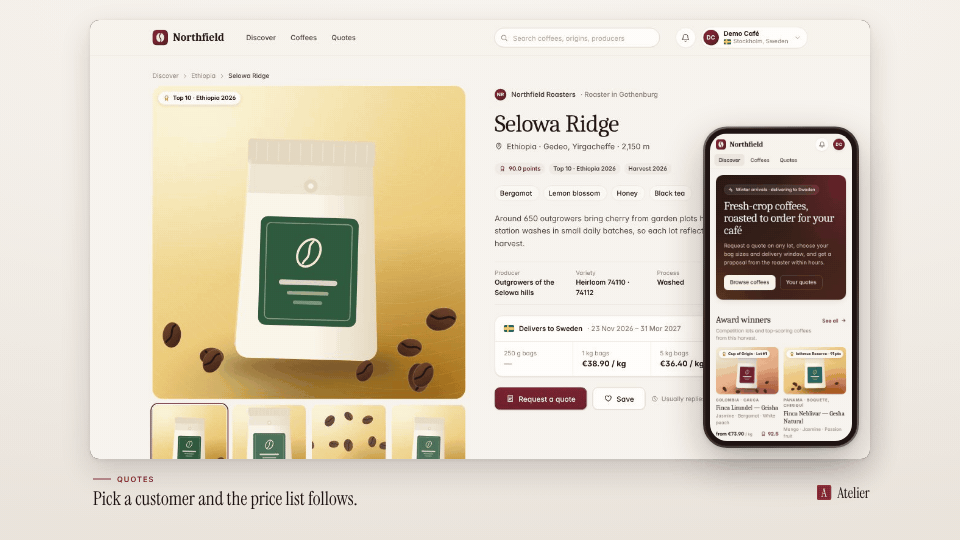

<!-- studio:component-preview:begin (generated by `retake components preview`; edit component.yaml instead) -->
# Picture in picture

`studio/layout-pip` · layout · v1.0.0

The main page in a card (or browser window), the other page floating over a corner — a phone around a mobile page — never covering what the main page acts on; the inset may grow while its page acts.

*Preview: the editorial theme, 1 s into the component, over the desktop sample screen; the manifest's preview samples.*

## Slots

| slot | type | default from | max chars | description |
|---|---|---|---|---|
| `screen` (required) | screen |  |  | The pages' captures (video + camera moves); the main page first. |

## Params

| param | type | default | description |
|---|---|---|---|
| `width` | number (800–1920) | 1560 | Main card width in design px (landscape); its height follows the main page's aspect, at most 878 px. |
| `radius` | number (0–64) | 18 | Corner radius of the main card in design px. |
| `shadow` | `none` \| `soft` \| `strong` | soft | Shadow under the main card (tinted with the theme's dark tone); the inset always has one. |
| `chrome` | boolean | false | A browser bar with the display URL above the main page — none for a local URL without one (the planner turns it on for themes whose layout is a browser window). |
| `inset_height` | number (0.3–0.9) | 0.7 | Height of a portrait inset (a phone) as a share of the main card's height. |
| `inset_width` | number (0.15–0.5) | 0.32 | Width of a landscape inset as a share of the main card's width. |
| `margin` | number (8–120) | 36 | Distance from the inset to the edges of the main card, in design px. |
| `emphasis` | `auto` \| `none` \| `grow` | auto | Draw the inset larger (×1.18) while its page acts: auto = for themes with style_bias balanced or motion. |

- variants: landscape, vertical, square
- theme tokens: `colors.text`, `colors.paper`, `colors.dark`, `background`
- geometry: see `component.yaml` (values may follow the params and the capture aspect)

Regenerate the preview and this block with `retake components preview studio/layout-pip`.
<!-- studio:component-preview:end -->
