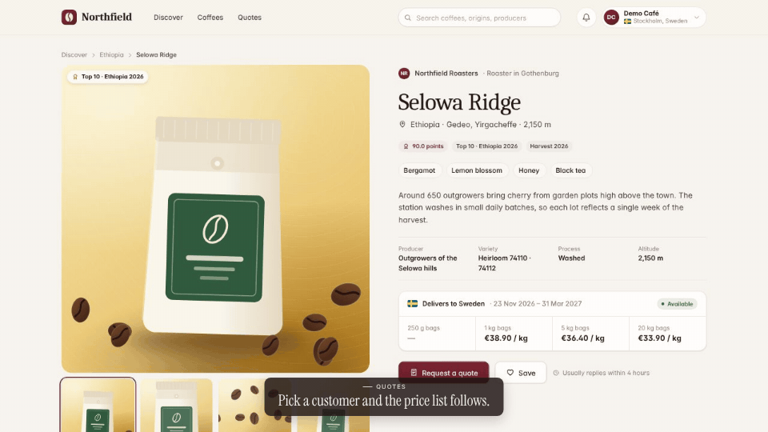

<!-- studio:component-preview:begin (generated by `studio components preview`; edit component.yaml instead) -->
# Raw

`studio/layout-raw` · layout · v1.0.0

The capture fills the whole frame, edge to edge (letterboxed with the theme background when its aspect differs); captions are drawn over its bottom.

*Preview: the editorial theme, 1 s into the component, over the desktop sample screen; the manifest's preview samples.*

## Slots

| slot | type | default from | max chars | description |
|---|---|---|---|---|
| `screen` (required) | screen |  |  | The capture (video + camera moves). |

## Params

None.

- variants: landscape, vertical
- theme tokens: `background`
- geometry: see `component.yaml` (values may follow the params and the capture aspect)

Regenerate the preview and this block with `studio components preview studio/layout-raw`.
<!-- studio:component-preview:end -->
