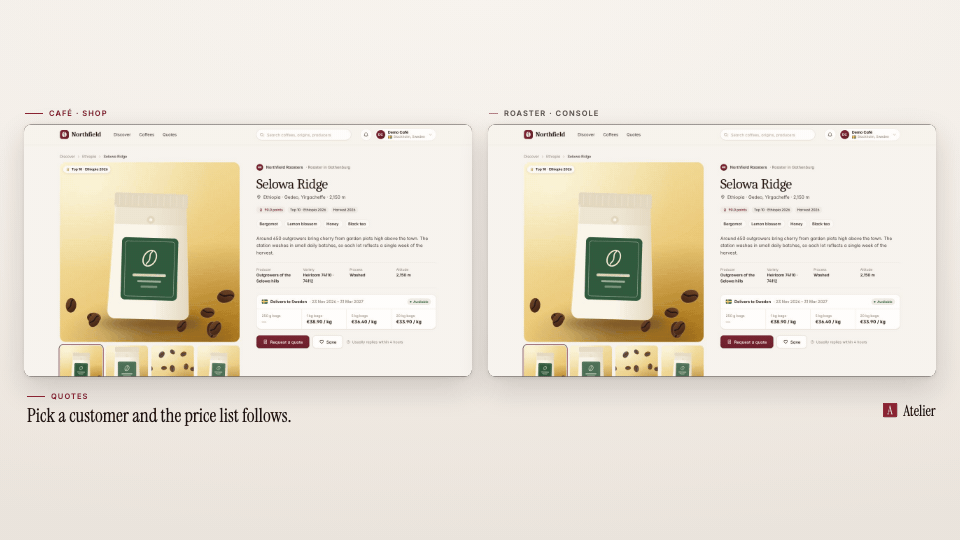

<!-- studio:component-preview:begin (generated by `studio components preview`; edit component.yaml instead) -->
# Split screen

`studio/layout-split` · layout · v1.0.0

Two pages of a multi-page scene side by side (stacked in vertical), each in a card or a browser window with its label, playing from the same source time; the caption below.

*Preview: the editorial theme, 1 s into the component, over the desktop sample screen; the manifest's preview samples.*

## Slots

| slot | type | default from | max chars | description |
|---|---|---|---|---|
| `screen` (required) | screen |  |  | The pages' captures (video + camera moves), one per pane. |

## Params

| param | type | default | description |
|---|---|---|---|
| `margin` | number (0–200) | 48 | Outer margin left and right of the pair, in design px (landscape). |
| `gap` | number (0–200) | 32 | Gap between the two pages, in design px. |
| `radius` | number (0–64) | 14 | Corner radius of each card in design px. |
| `shadow` | `none` \| `soft` \| `strong` | soft | Shadow under each card (tinted with the theme's dark tone). |
| `chrome` | boolean | false | A compact browser bar above each page with its display URL — none for a local URL without one (the planner turns it on for themes whose layout is a browser window). |
| `labels` | boolean | true | Each page's label (scenario `pages.<id>.label`) above it. |
| `emphasis` | `auto` \| `none` \| `dim` | auto | Dim the idle page a little while the other acts: auto = for themes with style_bias balanced or motion. |

- variants: landscape, vertical, square
- theme tokens: `colors.accent`, `colors.text`, `colors.muted`, `colors.paper`, `colors.dark`, `background`, `fonts.body`
- geometry: see `component.yaml` (values may follow the params and the capture aspect)

Regenerate the preview and this block with `studio components preview studio/layout-split`.
<!-- studio:component-preview:end -->
