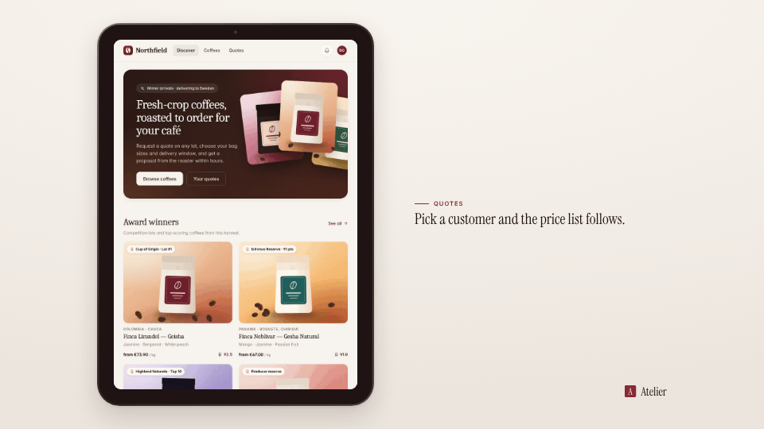

<!-- studio:component-preview:begin (generated by `studio components preview`; edit component.yaml instead) -->
# Tablet

`studio/layout-tablet` · layout · v1.0.0

The capture on an iPad-style tablet (uniform glass bezels with a camera, rounded display, thin metal edge), portrait with the caption beside it or landscape with the caption below, following the capture.

*Preview: the editorial theme, 1 s into the component, over the tablet sample screen; the manifest's preview samples.*

## Slots

| slot | type | default from | max chars | description |
|---|---|---|---|---|
| `screen` (required) | screen |  |  | The capture (video + camera moves). |

## Params

| param | type | default | description |
|---|---|---|---|
| `height` | number (600–900) | 880 | Portrait captures: display height in design px (landscape output). |
| `width` | number (700–1500) | 1240 | Landscape captures: display width in design px (landscape output); at most what lets the tablet and the caption block fit. |
| `finish` | `dark` \| `light` | dark | Edge and bezel: dark (space grey) or light (silver edge), both tinted by the theme. |
| `shadow` | `none` \| `soft` \| `strong` | soft | Shadow under the tablet (tinted with the theme's dark tone). |

- variants: landscape, vertical
- theme tokens: `colors.text`, `colors.paper`, `colors.dark`, `background`
- geometry: see `component.yaml` (values may follow the params and the capture aspect)

Regenerate the preview and this block with `studio components preview studio/layout-tablet`.
<!-- studio:component-preview:end -->
