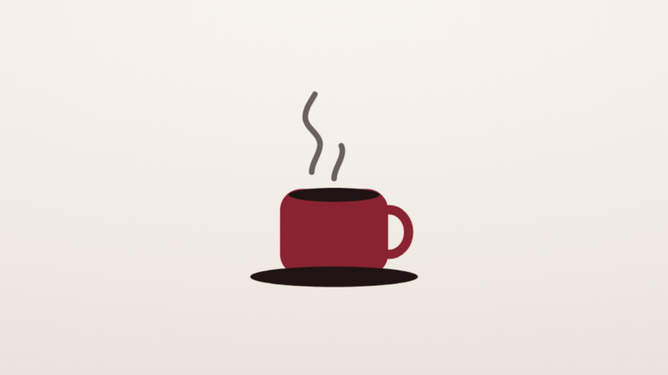

<!-- studio:component-preview:begin (generated by `studio components preview`; edit component.yaml instead) -->
# Lottie animation

`studio/lottie` · card · v1.0.0

A Lottie (bodymovin JSON) animation of the project — full frame on the theme background, or in a box over the capture — with optional colour replacement by theme colours.

*Preview: the editorial theme, 1.2 s into the component; the manifest's preview samples.*

## Slots

| slot | type | default from | max chars | description |
|---|---|---|---|---|
| `file` (required) | lottie |  |  | A Lottie animation (bodymovin .json) of the project or the theme. |

## Params

| param | type | default | description |
|---|---|---|---|
| `fit` | `contain` \| `cover` | contain | contain: the whole animation; cover: it fills the frame or the box (cropped). |
| `background` | string | theme | Full frame: behind the animation — theme (the theme background), a theme colour key (paper, dark, accent…), a CSS colour or none. |
| `size` | number (…–1) | 1 | Full frame: share of the frame the animation box takes (centred). |
| `loop` | boolean | false | Replay the animation for the whole use (default: play once, then hold the last frame). |
| `colors` | object | {} | Colours of the animation to replace: source colour (#rrggbb) → a theme colour key (accent, text, muted, paper, dark…) or a CSS colour. |

- duration 3 s (0.2–120 s)
- variants: landscape, vertical, square
- theme tokens: `background`, `colors.accent`, `colors.text`, `colors.muted`, `colors.paper`, `colors.dark`

Regenerate the preview and this block with `studio components preview studio/lottie`.
<!-- studio:component-preview:end -->
