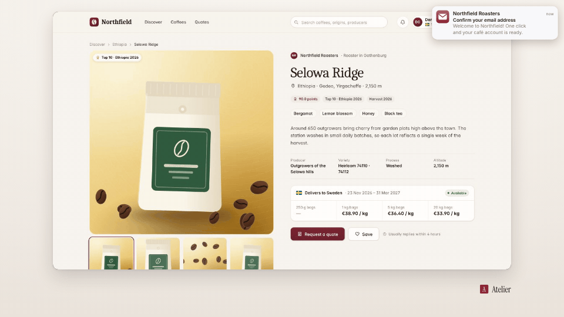

<!-- studio:component-preview:begin (generated by `studio components preview`; edit component.yaml instead) -->
# Mail notification

`studio/mail-notification` · overlay · v1.0.0

A system-style new-mail notification (sender, subject, first line) sliding over the footage, fed by a captured email or scenario values; macOS, Windows, iOS, Android or in-app styles.

*Preview: the editorial theme, 1.5 s into the component, over the desktop sample screen; the manifest's preview samples.*

## Slots

| slot | type | default from | max chars | description |
|---|---|---|---|---|
| `email` | email |  |  | A captured email (the `as` of a wait_for_email step). |
| `from` | text |  | 60 | Sender (default — the email's sender name or address). |
| `subject` | text |  | 120 | Subject (default — the email's subject). |
| `preview` | text |  | 200 | First line of the text (default — the email's). |
| `app` | text |  | 40 | Mail app name (default "Mail"). |
| `time` | text |  | 16 | Time shown ("now" by default). |
| `icon` | image |  |  | App icon URL (default — a mail glyph on the theme accent). |

## Params

| param | type | default | description |
|---|---|---|---|
| `style` | `macos` \| `windows` \| `ios-banner` \| `android` \| `in-app` | macos | Which system look. |
| `place` | `auto` \| `frame` \| `screen` | auto | frame: the corner of the video frame; screen: over the capture; auto: frame for macOS / Windows, screen for the others. |
| `appearance` | `auto` \| `light` \| `dark` | auto | Light or dark card (auto: dark on a dark theme background). |

- duration 4 s (1.5–30 s)
- variants: landscape, vertical, square
- theme tokens: `colors.accent`, `colors.text`, `colors.muted`, `colors.paper`, `colors.dark`, `fonts.body`, `style_bias`

Regenerate the preview and this block with `studio components preview studio/mail-notification`.
<!-- studio:component-preview:end -->
