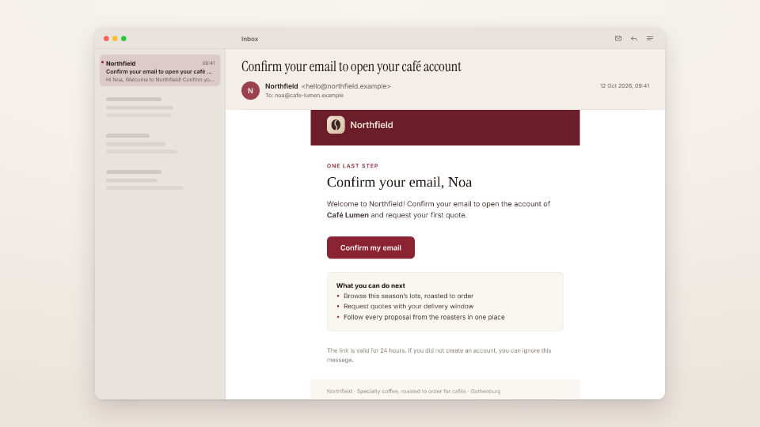

<!-- studio:component-preview:begin (generated by `studio components preview`; edit component.yaml instead) -->
# Mail view

`studio/mail-view` · card · v1.0.0

A mail client card showing a captured email — subject, sender, date and its rendered HTML from its top (scroll auto scrolls a long one slowly) — or scenario values, in a window with an inbox column on the theme background.

*Preview: the editorial theme, 3 s into the component; the manifest's preview samples.*

## Slots

| slot | type | default from | max chars | description |
|---|---|---|---|---|
| `email` | email |  |  | A captured email (the `as` of a wait_for_email step). |
| `from` | text |  | 60 | Sender name (default — the email's). |
| `address` | text |  | 80 | Sender address (default — the email's). |
| `subject` | text |  | 120 | Subject (default — the email's). |
| `date` | text |  | 40 | Date as shown (default — the email's date). |
| `body` | text |  | 800 | Body text when there is no captured email image. |
| `mailbox` | text |  | 24 | Mailbox name in the toolbar (default "Inbox", or "Inbox · Buyer" for a mail waited for with to: persona:buyer). |

## Params

| param | type | default | description |
|---|---|---|---|
| `width` | number (900–1700) | 1440 | Window width in design px (landscape). |
| `sidebar` | boolean | true | Inbox column on the left (landscape and square). |
| `scroll` | `auto` \| `none` | none | none: show the email's top; auto: scroll a tall email slowly from top to bottom. |
| `shadow` | `none` \| `soft` \| `strong` | soft | Shadow under the window. |

- duration 5.5 s (2–20 s)
- variants: landscape, vertical, square
- theme tokens: `colors.accent`, `colors.text`, `colors.muted`, `colors.paper`, `colors.dark`, `background`, `fonts.display`, `fonts.body`, `style_bias`

Regenerate the preview and this block with `studio components preview studio/mail-view`.
<!-- studio:component-preview:end -->
