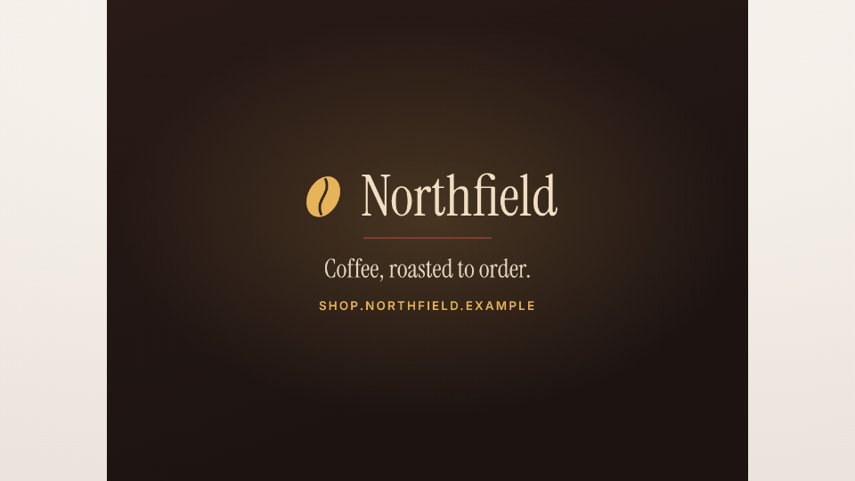

<!-- studio:component-preview:begin (generated by `studio components preview`; edit component.yaml instead) -->
# Your file

`studio/media` · card · v1.0.0

Your own video or image instead of a provided component — full frame (cover, or whole on the theme background) as an intro, outro, card or interstitial, or in a box over the capture as an overlay (alpha videos composite).

*Preview: the editorial theme, 1 s into the component; the manifest's preview samples.*

## Slots

| slot | type | default from | max chars | description |
|---|---|---|---|---|
| `file` (required) | media |  |  | A video (.mp4, .mov, .webm, .m4v) or an image (.png, .jpg, .jpeg, .webp, .svg) of the project or the theme. |

## Params

| param | type | default | description |
|---|---|---|---|
| `fit` | `auto` \| `cover` \| `contain` | auto | cover: fills the frame or the box (cropped); contain: the whole file, on the background; auto (default): cover when the file has about the frame's shape (covering keeps ≥ 80 % of each side), else contain — a 16:9 intro shows whole in the vertical variant. |
| `background` | string | theme | Full frame: around a contained or transparent file — theme (the theme background), a theme colour key (paper, dark, accent…), a CSS colour or none. |
| `volume` | number (0–1) | 1 | Video: volume of the file's own sound. |
| `from` | number (0–…) | 0 | Video: the second of the file the part shown starts at. |
| `to` | number |  | Video: the second of the file the part shown ends at (default: the file's end). |
| `loop` | boolean | false | Video: replay the part for the whole use (default: play once, then hold the last frame). |

- duration 3 s (0.2–600 s)
- variants: landscape, vertical, square
- theme tokens: `background`, `colors.paper`, `colors.dark`

Regenerate the preview and this block with `studio components preview studio/media`.
<!-- studio:component-preview:end -->
