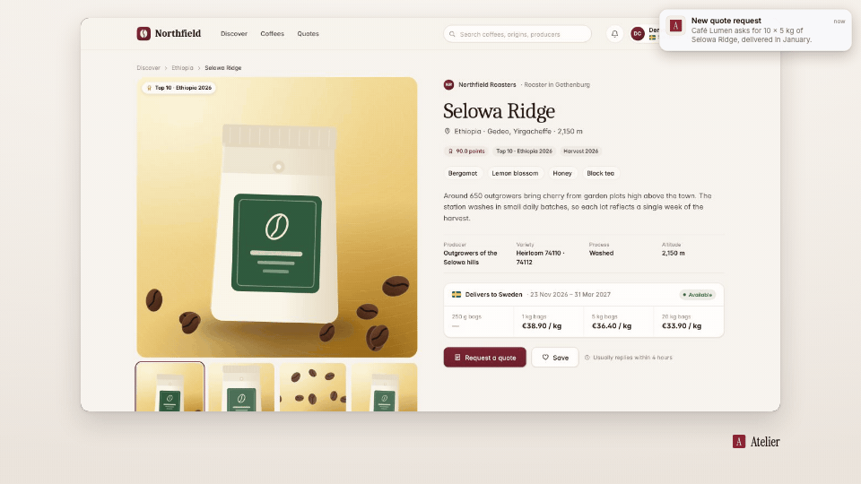

<!-- studio:component-preview:begin (generated by `retake components preview`; edit component.yaml instead) -->
# Notification

`studio/notification` · overlay · v1.0.0

A system-style notification (macOS, Windows, iOS banner, Android or an in-app toast) with icon, app, title, body and time, filled from the scenario or a captured web notification; slides in and out like the real one.

*Preview: the editorial theme, 1.5 s into the component, over the desktop sample screen; the manifest's preview samples.*

## Slots

| slot | type | default from | max chars | description |
|---|---|---|---|---|
| `notification` | notification |  |  | A web notification the product showed (its name — the tag — or its 1-based index). |
| `app` | text | theme.brand.name | 40 | App name (Windows / Android header). |
| `title` | text |  | 80 | Title line (default — the captured notification's title). |
| `body` | text |  | 200 | Body (default — the captured notification's body). |
| `time` | text |  | 16 | Time shown ("now" by default). |
| `icon` | image |  |  | App icon URL (default — the captured icon, else the theme logo). |

## Params

| param | type | default | description |
|---|---|---|---|
| `style` | `macos` \| `windows` \| `ios-banner` \| `android` \| `in-app` | macos | Which system look. |
| `place` | `auto` \| `frame` \| `screen` | auto | frame: the corner of the video frame; screen: over the capture; auto: frame for macOS / Windows, screen for the others. |
| `appearance` | `auto` \| `light` \| `dark` | auto | Light or dark card (auto: dark on a dark theme background). |

- duration 4 s (1.5–30 s)
- variants: landscape, vertical, square
- theme tokens: `colors.accent`, `colors.text`, `colors.muted`, `colors.paper`, `colors.dark`, `fonts.body`, `logo`, `brand.name`, `style_bias`

Regenerate the preview and this block with `retake components preview studio/notification`.
<!-- studio:component-preview:end -->
