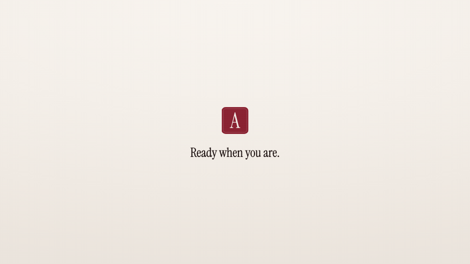

<!-- studio:component-preview:begin (generated by `retake components preview`; edit component.yaml instead) -->
# Outro minimal

`studio/outro-minimal` · outro · v1.0.0

Logo and one closing line fading in on the theme background — or only the logo and wordmark (logo_only).

*Preview: the editorial theme, 2 s into the component; the manifest's preview samples.*

## Slots

| slot | type | default from | max chars | description |
|---|---|---|---|---|
| `tagline` | text | scenario.outro.tagline | 70 | One closing line. |
| `logo` | image | theme.logo |  | Logo image (the theme logo by default). |

## Params

| param | type | default | description |
|---|---|---|---|
| `logo_only` | boolean | false | Show only the logo and the wordmark. |

- duration 3 s (1.2–8 s)
- variants: landscape, vertical
- theme tokens: `colors.text`, `colors.muted`, `background`, `fonts.display`, `logo`, `wordmark`, `style_bias`

Regenerate the preview and this block with `retake components preview studio/outro-minimal`.
<!-- studio:component-preview:end -->
