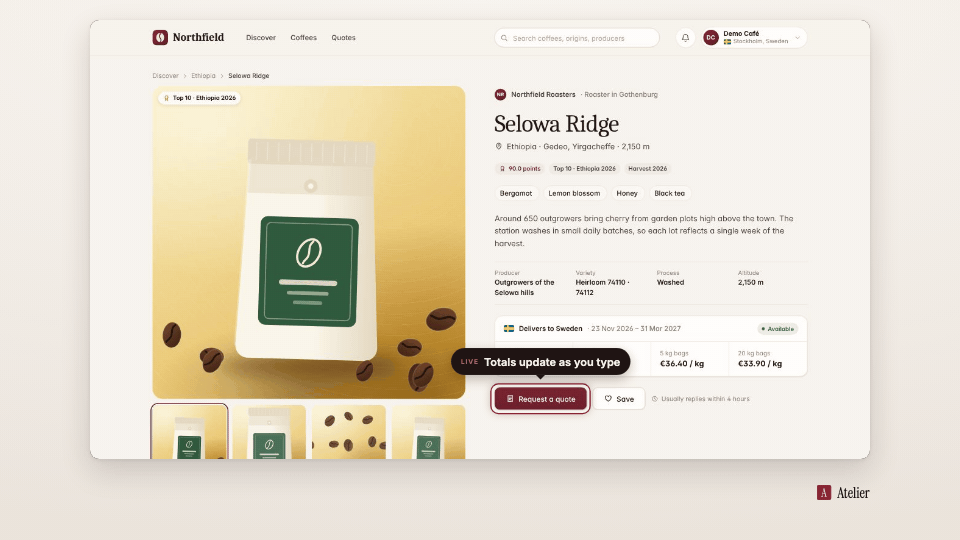

<!-- studio:component-preview:begin (generated by `retake components preview`; edit component.yaml instead) -->
# Callout

`studio/overlay-callout` · overlay · v1.0.0

A ring around the target and a pill (kicker + text) with a pointer toward it, above or below, never off-screen; pops in and fades out.

*Preview: the editorial theme, 0.9 s into the component, over the desktop sample screen; the manifest's preview samples.*

## Slots

| slot | type | default from | max chars | description |
|---|---|---|---|---|
| `text` (required) | text |  | 60 | The callout text. |
| `kicker` | text |  | 30 | Small uppercase line before the text. |

## Params

| param | type | default | description |
|---|---|---|---|
| `placement` | `auto` \| `above` \| `below` | auto | Side of the target (auto = above when there is room, else below). |
| `max_width` | number (200–1200) | 620 | Widest pill in design px. |
| `highlight` | boolean | true | Draw a ring around the target. |

- duration 2.5 s (0.8–30 s)
- variants: landscape, vertical
- theme tokens: `colors.accent`, `colors.text`, `colors.paper`, `colors.dark`, `fonts.body`, `style_bias`

Regenerate the preview and this block with `retake components preview studio/overlay-callout`.
<!-- studio:component-preview:end -->
