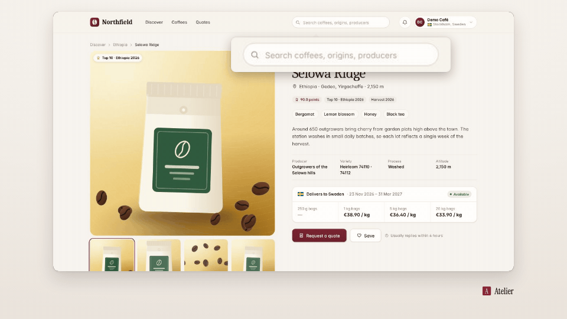

<!-- studio:component-preview:begin (generated by `retake components preview`; edit component.yaml instead) -->
# Typing loupe

`studio/overlay-loupe` · overlay · v1.0.0

A magnified live view of the field being typed into, beside it with a pointer and a ring on the field; readable in vertical and square.

*Preview: the editorial theme, 1 s into the component, over the desktop sample screen; the manifest's preview samples.*

## Slots

None.

## Params

| param | type | default | description |
|---|---|---|---|
| `zoom` | number (1.2–4) | 2 | Magnification relative to the capture on screen. |
| `max_width` | number (300–1800) | 900 | Widest lens in design px. |
| `placement` | `auto` \| `below` \| `above` | auto | Side of the field (auto: below when there is room). |
| `ring` | boolean | false | A ring on the field (off by default: the pointer shows the field; a spotlight draws its own). |

- duration 3 s (0.5–60 s)
- variants: landscape, vertical, square
- theme tokens: `colors.accent`, `colors.text`, `colors.paper`, `colors.dark`, `style_bias`

Regenerate the preview and this block with `retake components preview studio/overlay-loupe`.
<!-- studio:component-preview:end -->
