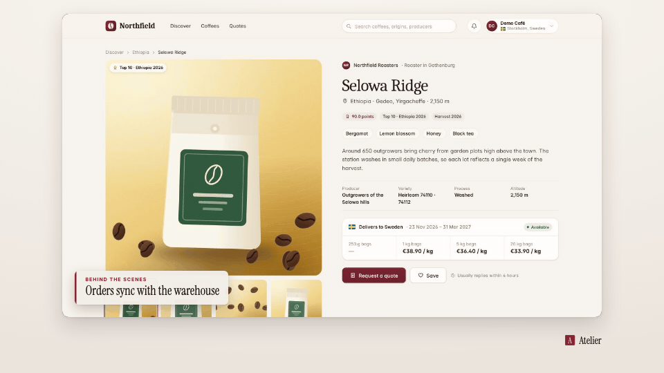

<!-- studio:component-preview:begin (generated by `retake components preview`; edit component.yaml instead) -->
# Lower third

`studio/overlay-lower-third` · overlay · v1.0.0

A paper panel with an accent bar, a small kicker and the text at the bottom left (or right) of the capture; slides in and fades out.

*Preview: the editorial theme, 1 s into the component, over the desktop sample screen; the manifest's preview samples.*

## Slots

| slot | type | default from | max chars | description |
|---|---|---|---|---|
| `text` (required) | text |  | 60 | Main line. |
| `kicker` | text |  | 40 | Small uppercase line above the text. |

## Params

| param | type | default | description |
|---|---|---|---|
| `side` | `left` \| `right` | left | Corner of the capture. |
| `max_width` | number (300–1400) | 760 | Widest panel in design px. |

- duration 3 s (1–30 s)
- variants: landscape, vertical
- theme tokens: `colors.accent`, `colors.text`, `colors.paper`, `fonts.display`, `fonts.body`, `style_bias`

Regenerate the preview and this block with `retake components preview studio/overlay-lower-third`.
<!-- studio:component-preview:end -->
