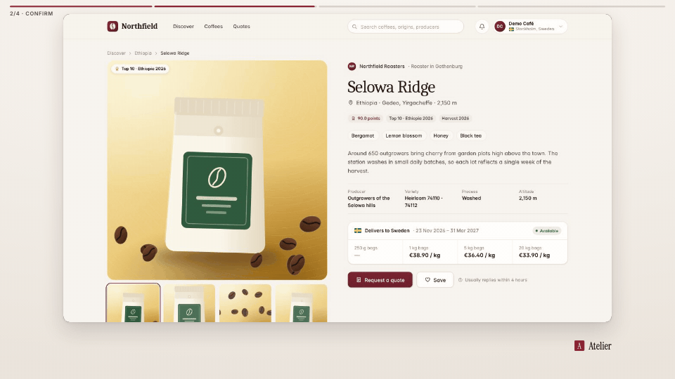

<!-- studio:component-preview:begin (generated by `retake components preview`; edit component.yaml instead) -->
# Chapter progress

`studio/overlay-progress` · overlay · v1.0.0

A thin segmented bar across the frame, one segment per chapter (scenes or cards), filling in the theme accent as the video plays; optional chapter label.

*Preview: the editorial theme, 5.6 s into the component, over the desktop sample screen; the manifest's preview samples.*

## Slots

None.

## Params

| param | type | default | description |
|---|---|---|---|
| `position` | `top` \| `bottom` | top | Edge of the frame. |
| `thickness` | number (2–16) | 5 | Bar height in design px. |
| `gap` | number (0–30) | 6 | Gap between chapters in design px. |
| `margin` | number (0–200) | 28 | Side margins in design px. |
| `labels` | boolean | false | Show the current chapter's name under the bar. |

- duration 12 s (1–3600 s)
- variants: landscape, vertical, square
- theme tokens: `colors.accent`, `colors.text`, `colors.paper`, `background`, `fonts.body`, `style_bias`

Regenerate the preview and this block with `retake components preview studio/overlay-progress`.
<!-- studio:component-preview:end -->
