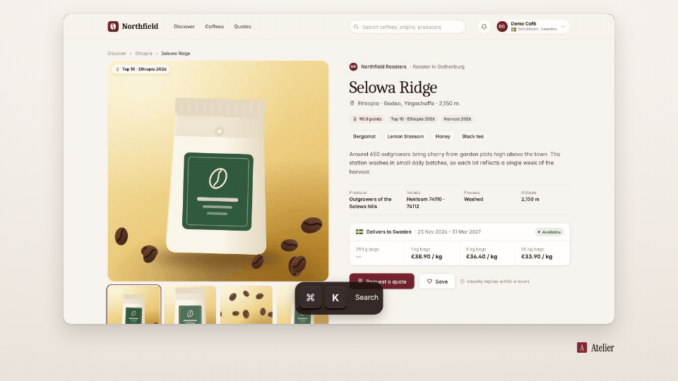

<!-- studio:component-preview:begin (generated by `retake components preview`; edit component.yaml instead) -->
# Keyboard shortcut

`studio/overlay-shortcut` · overlay · v1.0.0

Key caps of a key press (⌘ K, Ctrl + K, ↩) at the bottom of the capture, pressed on the real key press; macOS symbols or Windows / Linux words, theme tones.

*Preview: the editorial theme, 0.75 s into the component, over the desktop sample screen; the manifest's preview samples.*

## Slots

| slot | type | default from | max chars | description |
|---|---|---|---|---|
| `keys` (required) | text |  | 40 | The key combination in Playwright syntax ("Meta+K", "ControlOrMeta+Shift+P", "Enter"). |
| `times` | text |  | 4 | Number of presses (a "× N" chip when more than one). |
| `label` | text |  | 40 | Optional word beside the caps (what the shortcut does). |

## Params

| param | type | default | description |
|---|---|---|---|
| `platform` | `mac` \| `windows` \| `linux` | mac | Key conventions: macOS symbols (⌘ ⌥ ⇧ ⌃) or Windows / Linux words (Ctrl, Alt, Shift). |
| `position` | `bottom` \| `top` | bottom | Where on the capture. |
| `size` | number (32–120) | 62 | Key cap height in design px. |
| `tone` | `dark` \| `light` | dark | dark: a night-tone plate with light caps; light: a light plate with dark caps. |
| `hints` | boolean | false | macOS: the key's name under its symbol (command, shift…). |

- duration 1.8 s (0.4–10 s)
- variants: landscape, vertical, square
- theme tokens: `colors.accent`, `colors.text`, `colors.paper`, `colors.dark`, `fonts.body`, `style_bias`

Regenerate the preview and this block with `retake components preview studio/overlay-shortcut`.
<!-- studio:component-preview:end -->
