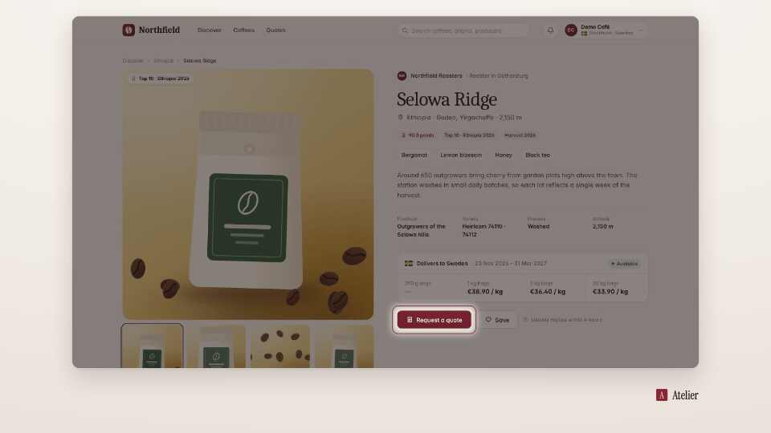

<!-- studio:component-preview:begin (generated by `retake components preview`; edit component.yaml instead) -->
# Spotlight

`studio/overlay-spotlight` · overlay · v1.0.0

Dims the capture except a soft rounded cut-out around the step's target, gliding from target to target over a run of steps; theme night tone, optional accent ring.

*Preview: the editorial theme, 1.2 s into the component, over the desktop sample screen; the manifest's preview samples.*

## Slots

None.

## Params

| param | type | default | description |
|---|---|---|---|
| `dim` | number (0.1–0.9) | 0.52 | Opacity of the dim. |
| `padding` | number (0–80) | 12 | Space around the target in design px. |
| `radius` | number (0–60) | 14 | Corner radius of the cut-out in design px. |
| `feather` | number (0–60) | 16 | Soft edge of the cut-out in design px. |
| `ring` | boolean | true | A thin accent ring around the cut-out. |
| `area` | `screen` \| `frame` | screen | What dims: the capture only (captions stay readable) or the whole frame. |

- duration 2.5 s (0.3–120 s)
- variants: landscape, vertical, square
- theme tokens: `colors.accent`, `colors.text`, `colors.paper`, `colors.dark`, `style_bias`

Regenerate the preview and this block with `retake components preview studio/overlay-spotlight`.
<!-- studio:component-preview:end -->
