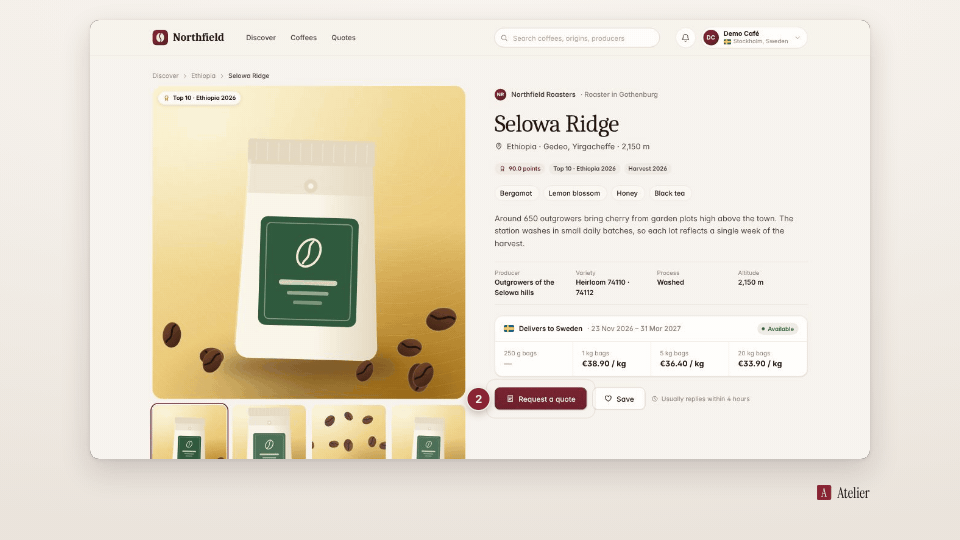

<!-- studio:component-preview:begin (generated by `studio components preview`; edit component.yaml instead) -->
# Step badge

`studio/overlay-steps` · overlay · v1.0.0

A numbered badge (1, 2, 3…) popping in beside the clicked target, never covering it, with a ring pulse on the target; accent colour, persists briefly.

*Preview: the editorial theme, 0.75 s into the component, over the desktop sample screen; the manifest's preview samples.*

## Slots

| slot | type | default from | max chars | description |
|---|---|---|---|---|
| `number` (required) | text |  | 3 | The step number (the planner counts the clicked steps). |

## Params

| param | type | default | description |
|---|---|---|---|
| `size` | number (24–96) | 44 | Badge diameter in design px. |
| `placement` | `auto` \| `left` \| `right` \| `above` \| `below` | auto | Side of the target (auto: the first of left, above, right, below with room). |
| `tone` | `accent` \| `dark` | accent | accent: the theme accent; dark: the theme's night tone. |
| `numbering` | `scene` \| `video` | scene | Count the steps per scene or across the whole video (read by the planner). |
| `pulse` | boolean | true | A ring pulse on the target at the click. |

- duration 1.6 s (0.5–30 s)
- variants: landscape, vertical, square
- theme tokens: `colors.accent`, `colors.text`, `colors.paper`, `colors.dark`, `fonts.body`, `style_bias`

Regenerate the preview and this block with `studio components preview studio/overlay-steps`.
<!-- studio:component-preview:end -->
