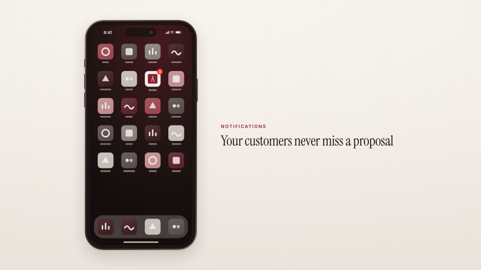

<!-- studio:component-preview:begin (generated by `studio components preview`; edit component.yaml instead) -->
# Phone home badge

`studio/phone-home-badge` · card · v1.0.0

A phone home screen whose product app icon gets a badge counting up (e.g. 0 → 3 new notifications), with a theme wallpaper, quiet icon grid and dock; optional kicker and title beside it.

*Preview: the editorial theme, 3 s into the component; the manifest's preview samples.*

## Slots

| slot | type | default from | max chars | description |
|---|---|---|---|---|
| `app` | text | theme.brand.name | 20 | Label under the product's app icon. |
| `icon` | image | theme.logo |  | The product's app icon (default the theme logo on the paper). |
| `kicker` | text |  | 40 | Small uppercase line beside the phone (layout left). |
| `title` | text |  | 90 | Title beside the phone (layout left). |

## Params

| param | type | default | description |
|---|---|---|---|
| `from` | integer (0–99) | 0 | Badge count at the start (0 = no badge). |
| `to` | integer (1–999) | 3 | Badge count at the end. |
| `start` | number (0–10) | 0.9 | Seconds before the first step. |
| `interval` | number (0.15–5) | 0.55 | Seconds between steps. |
| `row` | integer (0–4) | 1 | Row of the app icon (0 = top). |
| `col` | integer (0–3) | 2 | Column of the app icon (0 = left). |
| `badge` | `system` \| `accent` | system | Badge colour: the system red or the theme accent. |
| `time` | string | 9:41 | Status bar time. |
| `layout` | `center` \| `left` | center | center: the phone alone; left: the phone left of a kicker + title column (wide formats). |
| `height` | number (600–900) | 880 | Display height in design px. |
| `finish` | `dark` \| `light` | dark | Metal band. |
| `wallpaper` | `accent` \| `night` \| `paper` | night | Wallpaper mood (all from the theme). |

- duration 4 s (1.5–20 s)
- variants: landscape, vertical, square
- theme tokens: `colors.accent`, `colors.text`, `colors.muted`, `colors.paper`, `colors.dark`, `background`, `fonts.display`, `fonts.body`, `logo`, `brand.name`, `style_bias`

Regenerate the preview and this block with `studio components preview studio/phone-home-badge`.
<!-- studio:component-preview:end -->
