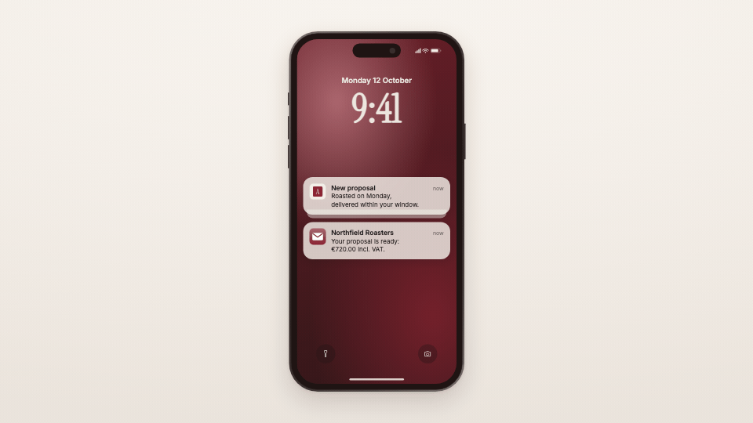

<!-- studio:component-preview:begin (generated by `retake components preview`; edit component.yaml instead) -->
# Phone lock screen

`studio/phone-lockscreen` · card · v1.0.0

A phone lock screen with a theme wallpaper, big time and date, and notifications arriving one by one — stacked newest first and grouped by app — from the scenario, a captured email or a captured web notification.

*Preview: the editorial theme, 4.2 s into the component; the manifest's preview samples.*

## Slots

| slot | type | default from | max chars | description |
|---|---|---|---|---|
| `email` | email |  |  | A captured email, shown as the last Mail notification. |
| `notification` | notification |  |  | A captured web notification, shown last. |
| `kicker` | text |  | 40 | Small uppercase line beside the phone (layout left). |
| `title` | text |  | 90 | Title beside the phone (layout left). |

## Params

| param | type | default | description |
|---|---|---|---|
| `time` | string | 9:41 | Big clock. |
| `date` | string | Monday 12 October | Date above the clock. |
| `notifications` | array | [] | Notifications in order of arrival {app, title, body, time?, icon?}. |
| `start` | number (0–10) | 0.9 | Seconds before the first notification arrives. |
| `interval` | number (0.3–5) | 1.1 | Seconds between arrivals. |
| `layout` | `center` \| `left` | center | center: the phone alone; left: the phone left of a kicker + title column (wide formats). |
| `height` | number (600–900) | 880 | Display height in design px. |
| `finish` | `dark` \| `light` | dark | Metal band. |
| `wallpaper` | `accent` \| `night` \| `paper` | accent | Wallpaper mood (all from the theme). |

- duration 5 s (2–20 s)
- variants: landscape, vertical, square
- theme tokens: `colors.accent`, `colors.text`, `colors.muted`, `colors.paper`, `colors.dark`, `background`, `fonts.display`, `fonts.body`, `logo`, `style_bias`

Regenerate the preview and this block with `retake components preview studio/phone-lockscreen`.
<!-- studio:component-preview:end -->
