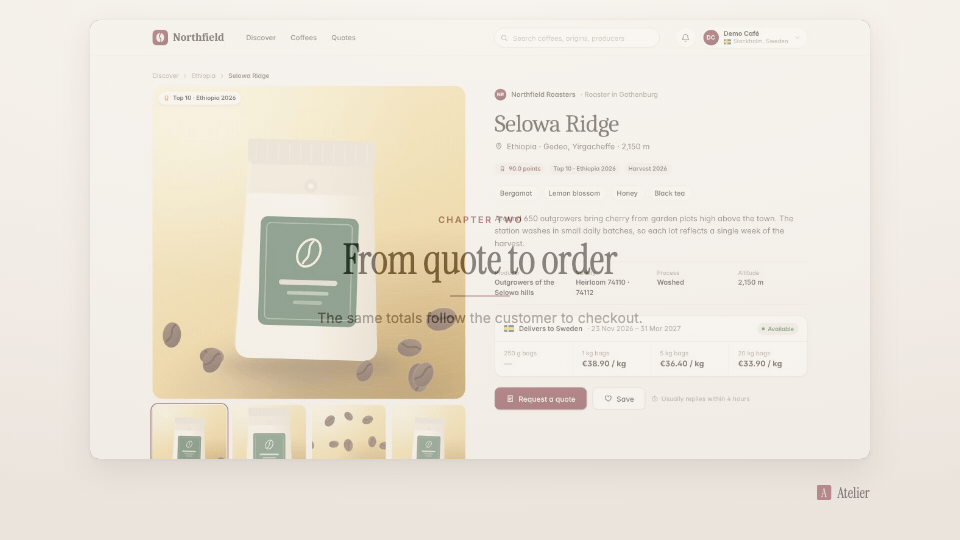

<!-- studio:component-preview:begin (generated by `retake components preview`; edit component.yaml instead) -->
# Crossfade

`studio/transition-crossfade` · transition · v1.0.0

The incoming segment fades in over the outgoing one (which holds its last frame), ease-in-out; a hint of scale with livelier themes.

*Preview: the editorial theme, 0.17 s into the component, over the desktop sample screen; the manifest's preview samples.*

## Slots

| slot | type | default from | max chars | description |
|---|---|---|---|---|
| `screen` (required) | screen |  |  | The segment this render wraps. |

## Params

| param | type | default | description |
|---|---|---|---|
| `duration` | number (0–3) | 0.35 | Length of the crossfade in seconds. |

- duration 0.35 s (0.1–3 s)
- variants: landscape, vertical
- theme tokens: `style_bias`

Regenerate the preview and this block with `retake components preview studio/transition-crossfade`.
<!-- studio:component-preview:end -->
