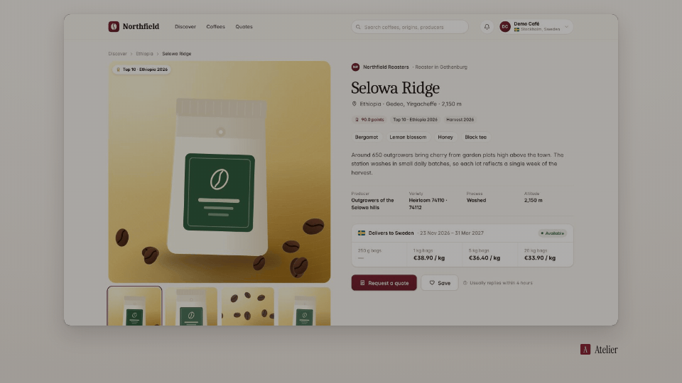

<!-- studio:component-preview:begin (generated by `studio components preview`; edit component.yaml instead) -->
# Fade through black

`studio/transition-fade-black` · transition · v1.0.0

The outgoing segment eases into black (or the theme's night tone), then the incoming one eases out of it; a slight scale breath with livelier themes.

*Preview: the editorial theme, 0.07 s into the component, over the desktop sample screen; the manifest's preview samples.*

## Slots

| slot | type | default from | max chars | description |
|---|---|---|---|---|
| `screen` (required) | screen |  |  | The segment this render wraps. |

## Params

| param | type | default | description |
|---|---|---|---|
| `duration` | number (0–3) | 0.4 | Length of the whole dip (out + in) in seconds. |
| `through` | `black` \| `night` | black | The dip colour: black, or the theme's night tone. |
| `color` | string |  | Any CSS colour for the dip (overrides `through`). |

- duration 0.4 s (0.1–3 s)
- variants: landscape, vertical
- theme tokens: `colors.dark`, `colors.text`, `colors.paper`, `style_bias`

Regenerate the preview and this block with `studio components preview studio/transition-fade-black`.
<!-- studio:component-preview:end -->
