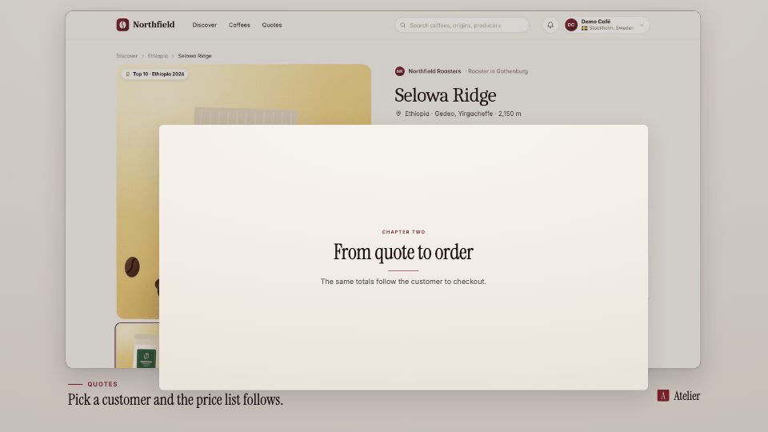

<!-- studio:component-preview:begin (generated by `retake components preview`; edit component.yaml instead) -->
# Tap to open

`studio/transition-tap-open` · transition · v1.0.0

A tap on the outgoing notification or app icon, then the next segment zooms out of it to full frame (rounded corners easing off); from the centre when the outgoing segment declares no tap target.

*Preview: the editorial theme, 0.36 s into the component, over the desktop sample screen; the manifest's preview samples.*

## Slots

| slot | type | default from | max chars | description |
|---|---|---|---|---|
| `screen` (required) | screen |  |  | The segment this render wraps. |

## Params

| param | type | default | description |
|---|---|---|---|
| `duration` | number (0.3–2) | 0.8 | Length of the transition in seconds. |
| `radius` | number (0–80) | 26 | Corner radius (design px) of the box at the start of the zoom. |
| `touch` | boolean | true | Draw the touch ring on the tap target. |
| `kind` | `crossfade` | crossfade | Overlapping transition (the planner reads it). |

- duration 0.8 s (0.3–2 s)
- variants: landscape, vertical, square
- theme tokens: `colors.text`, `colors.paper`, `colors.dark`, `style_bias`

Regenerate the preview and this block with `retake components preview studio/transition-tap-open`.
<!-- studio:component-preview:end -->
