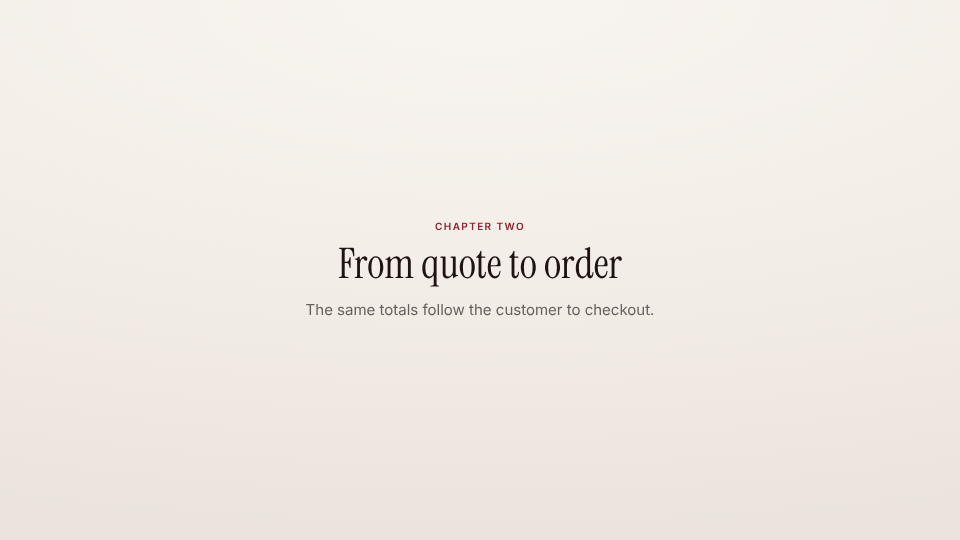

<!-- studio:component-preview:begin (generated by `retake components preview`; edit component.yaml instead) -->
# Card

`scaffolds/card` · card · v0.1.0

Full-screen chapter card with a kicker, a display title and an optional line of text, fading and rising in.

*Preview: the editorial theme, 1.5 s into the component; the manifest's preview samples.*

## Slots

| slot | type | default from | max chars | description |
|---|---|---|---|---|
| `title` (required) | text |  | 60 | The card title. |
| `kicker` | text |  | 40 | Small uppercase line above the title. |
| `text` | text |  | 140 | Optional supporting line under the title. |

## Params

| param | type | default | description |
|---|---|---|---|
| `align` | `center` \| `left` | center | Alignment of the column. |

- duration 2.5 s (1–10 s)
- variants: landscape, vertical
- theme tokens: `colors.accent`, `colors.text`, `colors.muted`, `background`, `fonts.display`, `fonts.body`

Regenerate the preview and this block with `retake components preview scaffolds/card`.
<!-- studio:component-preview:end -->
