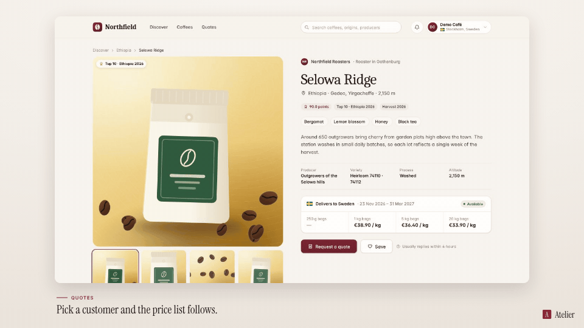

<!-- studio:component-preview:begin (generated by `studio components preview`; edit component.yaml instead) -->
# Layout

`scaffolds/layout` · layout · v0.1.0

Capture in a rounded card with a soft shadow on the theme background, caption area below, brand mark in a corner.

*Preview: the editorial theme, 1 s into the component, over the desktop sample screen; the manifest's preview samples.*

## Slots

| slot | type | default from | max chars | description |
|---|---|---|---|---|
| `screen` (required) | screen |  |  | The capture (video + camera moves). |

## Params

| param | type | default | description |
|---|---|---|---|
| `radius` | number (0–64) | 18 | Corner radius of the card in design px. |
| `shadow` | `none` \| `soft` \| `strong` | soft | Shadow under the card. |

- variants: landscape, vertical, square
- theme tokens: `colors.text`, `colors.paper`, `background`
- geometry: see `component.yaml` (values may follow the params and the capture aspect)

Regenerate the preview and this block with `studio components preview scaffolds/layout`.
<!-- studio:component-preview:end -->
