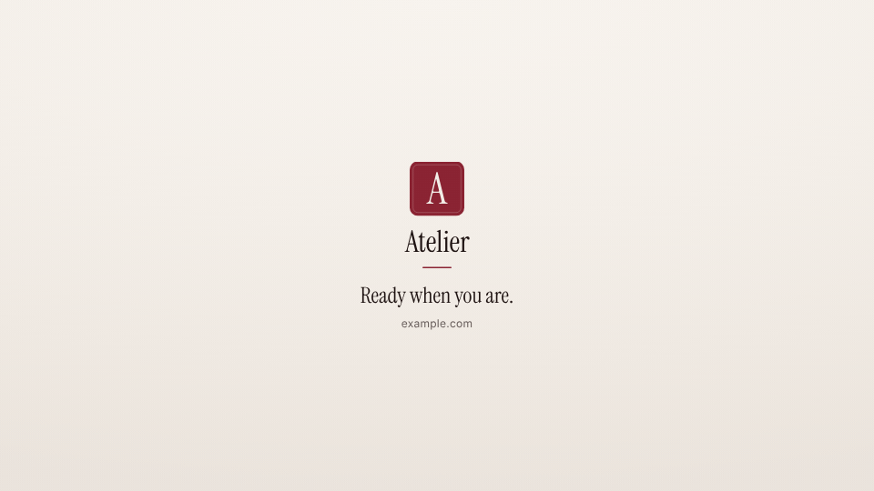

<!-- studio:component-preview:begin (generated by `studio components preview`; edit component.yaml instead) -->
# Outro

`scaffolds/outro` · outro · v0.1.0

Big logo, wordmark, accent rule, tagline and url, rising in one after the other on the theme background.

*Preview: the editorial theme, 2.6 s into the component; the manifest's preview samples.*

## Slots

| slot | type | default from | max chars | description |
|---|---|---|---|---|
| `tagline` | text | scenario.outro.tagline | 70 | One closing line. |
| `url` | url | theme.brand.url | 40 | Address shown under the tagline. |
| `logo` | image | theme.logo |  | Logo image (the theme logo by default). |

## Params

| param | type | default | description |
|---|---|---|---|
| `logo_size` | number (48–240) | 120 | Logo height in design px. |
| `stagger` | number (0–0.5) | 0.12 | Seconds between the entrances of two lines. |

- duration 3 s (1.5–8 s)
- variants: landscape, vertical
- theme tokens: `colors.accent`, `colors.text`, `colors.muted`, `background`, `fonts.display`, `fonts.body`, `logo`, `wordmark`, `brand.url`

Regenerate the preview and this block with `studio components preview scaffolds/outro`.
<!-- studio:component-preview:end -->
