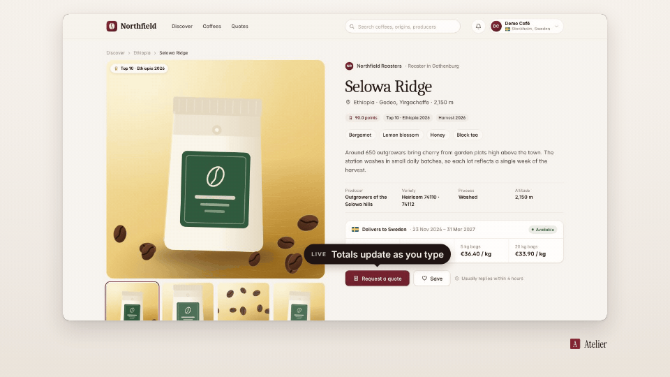

<!-- studio:component-preview:begin (generated by `retake components preview`; edit component.yaml instead) -->
# Overlay

`scaffolds/overlay` · overlay · v0.1.0

Callout pill with a pointer above or below the step target (a lower third without a target); pops in and fades out.

*Preview: the editorial theme, 0.8 s into the component, over the desktop sample screen; the manifest's preview samples.*

## Slots

| slot | type | default from | max chars | description |
|---|---|---|---|---|
| `text` (required) | text |  | 60 | The callout text. |
| `kicker` | text |  | 30 | Small uppercase line before the text. |

## Params

| param | type | default | description |
|---|---|---|---|
| `placement` | `auto` \| `above` \| `below` | auto | Side of the target (auto = above when there is room). |
| `max_width` | number (200–1200) | 560 | Widest pill in design px. |

- duration 2.5 s (0.8–30 s)
- variants: landscape, vertical
- theme tokens: `colors.accent`, `colors.text`, `colors.paper`, `fonts.body`

Regenerate the preview and this block with `retake components preview scaffolds/overlay`.
<!-- studio:component-preview:end -->
