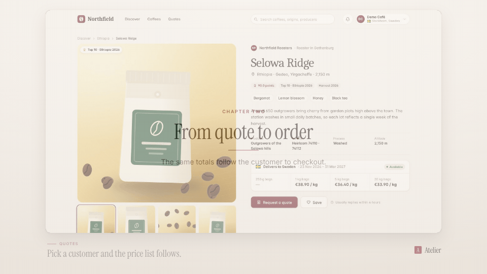

<!-- studio:component-preview:begin (generated by `studio components preview`; edit component.yaml instead) -->
# Transition

`scaffolds/transition` · transition · v0.1.0

Crossfade between two segments, or a dip through the theme paper, text or accent colour.

*Preview: the editorial theme, 0.2 s into the component, over the desktop sample screen; the manifest's preview samples.*

## Slots

| slot | type | default from | max chars | description |
|---|---|---|---|---|
| `screen` (required) | screen |  |  | The segment this render wraps. |

## Params

| param | type | default | description |
|---|---|---|---|
| `through` | `none` \| `paper` \| `text` \| `accent` | none | Colour to dip through (none = crossfade). |

- duration 0.4 s (0.1–2 s)
- variants: landscape, vertical
- theme tokens: `colors.paper`, `colors.text`, `colors.accent`

Regenerate the preview and this block with `studio components preview scaffolds/transition`.
<!-- studio:component-preview:end -->
